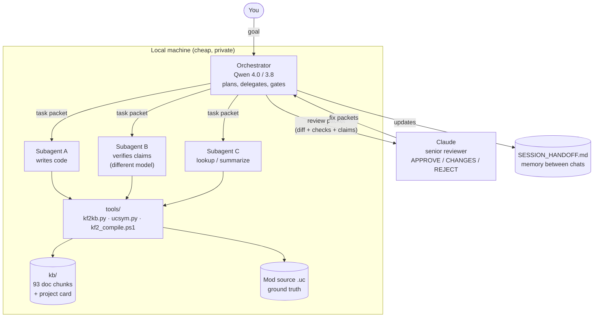
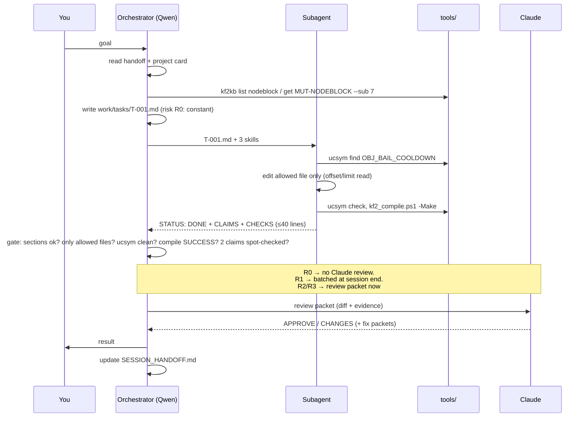

# KF2 Agent Kit

A small, tool-assisted workflow that lets **cheap local LLMs** (Qwen 3.8 / 4.0 and friends) do real modding work on an UnrealScript codebase (the *KF2Bots* mod for Killing Floor 2) — while **Claude acts as senior reviewer** — without blowing the context window and with as little hallucination as possible.

It is not a framework or a service. It is **markdown skills + three small scripts + a pre-chunked knowledge base**. Any agent harness that can read files and run shell commands can use it.

> New here? Read this file top to bottom once, then use [SETUP.md](SETUP.md) to install and [SESSION_HANDOFF.md](SESSION_HANDOFF.md) to see where the project currently stands.

---

## Contents
1. [The problem this solves](#1-the-problem-this-solves)
2. [The big picture](#2-the-big-picture)
3. [Roles: who does what](#3-roles-who-does-what)
4. [Repository layout](#4-repository-layout)
5. [Component reference](#5-component-reference)
6. [A task from start to finish](#6-a-task-from-start-to-finish)
7. [How it saves context](#7-how-it-saves-context)
8. [How it reduces hallucination](#8-how-it-reduces-hallucination)
9. [Risk tiers: when Claude is involved](#9-risk-tiers-when-claude-is-involved)
10. [Session memory: the handoff file](#10-session-memory-the-handoff-file)
11. [Adapting it to another game or mod](#11-adapting-it-to-another-game-or-mod)
12. [Status and honest limits](#12-status-and-honest-limits)
13. [FAQ](#13-faq)

---

## 1. The problem this solves

The mod is five UnrealScript files (~12,700 lines) plus a 130 KB architecture document (~66,000 tokens). Local models fail on this in predictable ways:

| Failure | Why it happens | What the kit does |
|---|---|---|
| Context overflow | The architecture doc alone fills most local context windows | Doc is pre-split into 93 chunks of 150–2,200 tokens; models fetch one slice at a time |
| Invented functions / variables | Model "remembers" an API that does not exist in this codebase | `ucsym.py` checks every identifier against an index built from the real source |
| Wrong line numbers | Doc is a snapshot; source moved on | `kf2kb.py fresh` compares line count + SHA-256 per file against the doc |
| Endless fix loops | Model retries compile errors forever | Hard limit of 3 attempts, then escalate |
| Unreadable compile logs | A `kfeditor make` log can be thousands of lines | Wrapper prints ≤ ~30 lines (`RESULT` + first errors) |
| Lost progress between chats | Each chat starts blank | `SESSION_HANDOFF.md` is written at the end of every session |
| Self-grading | The author model approves its own work | Verifier must be a *different* model; Claude reviews evidence packets |

---

## 2. The big picture



Key idea: **information flows as small, structured files, not as chat history.** The orchestrator never reads source; subagents never see the whole doc; Claude never sees whole files. Everyone gets the minimum evidence needed for their job.

---

## 3. Roles: who does what

| Role | Model | Reads | Writes | Skill it follows |
|---|---|---|---|---|
| **Reviewer ("big boss")** | Claude | review packets, a few cited source lines | verdict + fix packets | `claude-review-gate` |
| **Orchestrator** | Qwen 4.0 or 3.8 | project card, handoff, one-line results | `work/TASKS.md`, task packets, review packets, handoff | `orchestrator-protocol`, `session-handoff` |
| **Subagents** | other local models / quants / finetunes | one task packet, a few kb slices, source ranges | code changes + a structured result file | `subagent-worker`, `kf2-uscript-guardrails`, `kf2-compile-loop`, `kf2-arch-lookup` |
| **You** | human | summaries | goals, answers to blocking questions | — |

Routing hint (fill in with your real models): small fast quant for lookup/summaries → strongest coder for writing → a *different* finetune for verification.

---

## 4. Repository layout

```
kf2-agent-kit/
├── README.md                 ← you are here (concepts)
├── SETUP.md                  ← install + daily-use steps
├── SESSION_HANDOFF.md        ← living memory file; READ FIRST when continuing work
│
├── skills/                   ← instructions for the models (each: one folder + SKILL.md)
│   ├── kf2-arch-lookup/          how to fetch only the needed doc slice and verify it
│   ├── kf2-uscript-guardrails/   language gotchas, ownership rules, anti-invention rules
│   ├── kf2-compile-loop/         setup, compile, read result, 3-attempt limit
│   ├── orchestrator-protocol/    plan → packet → gate → escalate
│   ├── subagent-worker/          contract for executing one task packet
│   ├── claude-review-gate/       how Claude reviews evidence packets
│   └── session-handoff/          end-of-session memory protocol
│
├── tools/                    ← scripts the models run instead of reading big things
│   ├── kf2kb.py                  split / list / get / sym / fresh  (doc knowledge base)
│   ├── ucsym.py                  index / find / check / stats      (source symbol truth)
│   └── kf2_compile.ps1           -Setup / -Doctor / -Make / -Summarize (Windows)
│
├── kb/                       ← generated chunks of the architecture doc (+ hand-written card)
│   ├── 00_PROJECT_CARD.md        ~1k tokens, always loaded
│   ├── INDEX.md, index.json      chunk catalogue
│   ├── symbols_doc.json          doc's A–Z symbol index, machine-readable
│   ├── native_allow.txt          natives the doc lists as "not found in SDK"
│   └── NNN_<tag>.md              one file per doc section (93 files)
│
├── templates/                ← fill-in-the-blank files passed between agents
│   ├── task_packet.md            orchestrator → subagent
│   ├── review_packet.md          orchestrator → Claude
│   └── handoff.md                end-of-session memory format
│
├── config/kf2_paths.example.json ← copy to kf2_paths.json (git-ignored)
├── docs/                     ← put KF2_Current_Architecture.md here (input to kf2kb split)
├── work/                     ← runtime scratch: TASKS.md, tasks/, review/, LESSONS.md (git-ignored)
└── logs/                     ← compile logs (git-ignored)
```

---

## 5. Component reference

### 5.1 Knowledge base (`kb/`, built by `kf2kb.py split`)

The architecture doc has a consistent structure: parts → systems tagged `@SYS-<NAME>` → seven numbered subsections each:

| `--sub` | Content | Typical use |
|---|---|---|
| 1 | Summary | "what is this?" |
| 2 | Explanation | understand behaviour |
| 3 | Pipeline | order of operations |
| 4 | Inputs/outputs, single-writer | ownership checks |
| 5 | FLOW | control flow |
| 6 | Technical reference | exact signatures/line ranges |
| 7 | **Where to fix** | cheapest, most useful for edits |

`split` writes one file per heading, an index, a machine-readable symbol table (943 rows → 858 unique names), and replaces the 900-row A–Z index with a stub so nobody loads it by accident.

### 5.2 `tools/kf2kb.py` — doc lookup

```bash
python tools/kf2kb.py list heal                 # which chunks mention "heal"
python tools/kf2kb.py get NAV-STUCK --sub 7     # just "Where to fix" for that system
python tools/kf2kb.py get 080 --max-chars 3000  # by chunk number, with a hard cap
python tools/kf2kb.py sym IdleWatchdog          # doc's symbol index: kind, file:line, owning tag
python tools/kf2kb.py fresh docs/KF2_Current_Architecture.md <ModSrcDir>
```
`fresh` is the staleness alarm: if a file's line count or SHA-256 prefix differs from the doc's "Verified against" table, every line number the doc gives for that file is untrusted.

### 5.3 `tools/ucsym.py` — source truth and hallucination check

```bash
python tools/ucsym.py index --mod <ModSrcDir> --sdk <SdkSrcDir> --out symbols_src.json
python tools/ucsym.py find FollowStart          # exists? where? [mod|sdk]
python tools/ucsym.py check path/to/Changed.uc  # heuristic lint, ≤25 issues printed per file
```
`check` reports: calls to names that exist nowhere (mod, SDK, builtins, allow-list), `GotoState('X')` with unknown states, timer names that are not functions, `local` declarations after a statement, unbalanced braces. It is a **text heuristic, not a compiler** — it validates names, not types.

### 5.4 `tools/kf2_compile.ps1` — build wrapper (Windows)

Wraps the official procedure (`kfeditor make -useunpublished -log` from `<KF2SDKdir>\Binaries\Win64`) and returns:

```
RESULT: FAILURE  errors=2 warnings=1
E KF2Bot.uc(1234): <message>
W KF2BotBase.uc(77): <message>
FULL LOG: logs\last_make.log
```
Exit codes: `0` success · `1` compile errors · `2` tooling/config problem. `-Setup` creates `KFGame\Src\<Mod>\Classes` and adds `ModPackages=<Mod>` to `KFEditor.ini` (idempotent, writes a `.bak`). Paths come from `config/kf2_paths.json`, never from the skills.

### 5.5 Skills (`skills/*/SKILL.md`)

Each is 30–55 lines with `name` + `description` frontmatter so a harness can auto-select it. They are deliberately short: a 7–14B model follows a one-page checklist far better than a long essay.

| Skill | One-line purpose |
|---|---|
| `kf2-arch-lookup` | Card first → locate → smallest slice → verify symbol → verify against source; ≤ 3 chunks per task |
| `kf2-uscript-guardrails` | Compile-breaking language rules, class-chain rules, single-writer table, "no symbol = doesn't exist" |
| `kf2-compile-loop` | One-time setup, build, read summary, max 3 attempts, first-error-only fixing |
| `orchestrator-protocol` | Task decomposition, risk tiers, packets, 5-step gate, routing, budget and escalation rules |
| `subagent-worker` | Read only what's listed, smallest diff, return fixed format, say `UNKNOWN` instead of guessing |
| `claude-review-gate` | Evidence-based review checklist, verdict format, fix packets, lessons |
| `session-handoff` | When and how to rewrite/append the handoff file |

### 5.6 Templates and the packet idea

A **packet** is a small file that is the *entire interface* between two agents:

- `task_packet.md` — goal, risk tier, `read_first` kb tags, `allowed_files`, constraints, acceptance checks, out-of-scope, known quirks to leave alone.
- Subagent result — `STATUS / CHANGES / CLAIMS / CHECKS / UNKNOWNS / DIFF`, every claim with a `[File:line]` citation.
- `review_packet.md` — task + diff + raw `ucsym`/compile output + claims + spot-check results.

Because packets are files, they survive context resets, can be audited later, and keep each agent's context small.

### 5.7 The project card (`kb/00_PROJECT_CARD.md`)

One page (~1k tokens) loaded by everyone: the 5 files and their roles, class chain, the hub's priority order P1–P10, squad structure, single-writer rules, hard language rules, known quirks not to "fix", and the list of opaque native functions. It is the only content that is *always* in context.

---

## 6. A task from start to finish

Illustrative example: *"Make bots wait 10 s instead of 8 s before retrying a blocked nav node."* (The doc names the 8-second value `OBJ_BAIL_COOLDOWN`.)



Gate order (cheap → expensive): result format → scope (only allowed files) → `ucsym check` → compile → two spot-checked claims → Claude (if tier requires). A single false claim rejects the result and is logged in `work/LESSONS.md` with the model name.

---

## 7. How it saves context

| Technique | Effect |
|---|---|
| Doc pre-split into 93 chunks | 66k tokens → typically 300–1,500 tokens per task |
| `--sub 7` ("where to fix") first | ~150–400 tokens, often enough |
| Hard caps (≤ 3 chunks, ≤ 9,000 chars, `offset/limit` reads) | No accidental whole-file reads |
| 1k-token project card as the only permanent context | Everything else is on demand |
| Compile wrapper | ≤ 30 lines instead of the full log |
| Packets instead of conversation | Each agent starts clean; nothing carried that isn't needed |
| Orchestrator holds one-line results only | Its window lasts through many tasks (rotate at ~60%) |
| Claude sees diffs + evidence, never whole files | Expensive tokens spent on judgment, not reading |

Approximate budget:

| Item | ≈ tokens |
|---|---|
| Project card | 1,000 |
| One kb "where to fix" slice | 150–400 |
| One full kb chunk | 600–2,200 |
| Whole architecture doc | 66,000 (never loaded) |
| Compile summary | < 500 |

---

## 8. How it reduces hallucination

Five layers, from "prevent" to "catch":

1. **Ground truth ordering** — source code › `ucsym` index › kb chunk › glossary prose. Doc claims tagged `(INFERRED)` / `(UNVERIFIED)` stay unverified in outputs.
2. **No-symbol-no-use rule** — an identifier you cannot find in source or via `ucsym find` does not exist for you. Natives the doc cannot verify may only be used by copying an existing call site, with a citation.
3. **Mandatory citations** — every claim carries `[Mut:2325]`-style file:line proof; uncited claims must be labelled `GUESS`.
4. **Mechanical checks** — `ucsym check` + real compile before anything is accepted; staleness check for line numbers.
5. **Independent verification** — author ≠ verifier; orchestrator spot-checks claims; Claude verifies claims against source for R2/R3, and *all* of an author's claims once one is found false.

Plus an escape hatch that makes honesty cheaper than guessing: a subagent may return `UNKNOWN` or `BLOCKED`, which is always acceptable; a confident wrong answer is not.

---

## 9. Risk tiers: when Claude is involved

| Tier | Examples | Gate before merge | Claude |
|---|---|---|---|
| **R0** | constant/config value, log text, comment | `ucsym` + compile | never |
| **R1** | edit inside one function, no new symbol | + diff summary | batched review at session end |
| **R2** | new function/var/state/timer, or 2+ files | + evidence packet | review before merge |
| **R3** | single-writer state, hub priority order, follower decision order, class chain, roster/squad arrays | + second subagent re-verifies claims | review before merge |

Immediate escalation (any tier): a would-be second writer of owned state, doc/source disagreement, an unresolvable `UNKNOWN`, the same error after two fixes, or three failed attempts.

---

## 10. Session memory: the handoff file

`SESSION_HANDOFF.md` is how work survives across chats and across models. Rules (enforced by the `session-handoff` skill):

- **Rewrite** "Current state" every session; **append-only** for decision log, lessons, session log.
- Facts are tagged `VERIFIED(<proof>)`, `UNVERIFIED` or `ASSUMED`.
- ≤ 200 lines; older log entries go to `handoff_archive/`.
- Always contains a "Resume in 3 steps" block so a cold model starts correctly.
- Written at the end of every session, when context reaches ~70%, or before switching models.

---

## 11. Adapting it to another game or mod

Game-agnostic: the packet/gate/review protocol, `kf2kb.py` (any markdown with `#`/`##`/`###` headings and optional `@SYS-TAGS`), `ucsym.py` (any UnrealScript project; other languages would need new declaration regexes), the templates, and the handoff protocol.

Game-specific (replace these): `kb/00_PROJECT_CARD.md`, `kf2-uscript-guardrails`, `kf2-arch-lookup`'s "which chunk for which job" table, `config/kf2_paths.json`, and the compile script's path logic.

Steps: write the project card → write guardrails from your engine's real compile errors → generate the kb from your own architecture doc → index your source → pilot with one R0 task.

---

## 12. Status and honest limits

| Component | State |
|---|---|
| `kf2kb.py` split/list/get/sym | Tested on the real architecture doc |
| `ucsym.py` index/find/check | Tested on a synthetic `.uc` file only; not yet on the real mod/SDK |
| `kf2kb.py fresh` | Logic tested with dummy files; not yet run against the real source |
| `kf2_compile.ps1` | **Untested** (no Windows/KF2 SDK where written); log-format regexes are assumptions |
| Skills / templates | **Untested with real local models** — expect wording tweaks after the first pilot |

Known limitations:
- `ucsym check` cannot see types; `obj.Method()` is validated by name only.
- The kit reduces hallucination and context use; it does not eliminate either. The compile and your in-game testing remain the real judges.
- Whether your harness loads `SKILL.md` files natively is unknown; [SETUP.md](SETUP.md) gives a fallback prompt.
- The architecture doc's Appendix B glossary disagrees with the code in places; the skills tell models to prefer system chunks.

Track progress and open questions in [SESSION_HANDOFF.md](SESSION_HANDOFF.md).

---

## 13. FAQ

**Do I need Claude for everything?** No. Tier R0 never involves it; R1 is batched. The point is to spend Claude on risky changes.

**Can the orchestrator and a subagent be the same model?** Yes for writing; no for verifying. Author and verifier must be different instances, ideally different finetunes.

**Why markdown skills instead of a framework?** They work with any harness, are readable by small models, and are diffable in git.

**Why not just give the model the whole doc?** At ~66k tokens it displaces the code, and small models degrade sharply with long contexts. Slices keep the signal-to-noise high.

**Is it safe for my game install?** The compile script only creates a mod folder, edits `KFEditor.ini` (after writing a `.bak`) and runs the SDK's `make`. Anything destructive, path changes or Steam-file edits are listed as "stop and ask the user" in the orchestrator skill.

**What do I do first?** [SETUP.md](SETUP.md) → run one trivial constant change through the whole loop → record what went wrong in `SESSION_HANDOFF.md` → tighten the skills.

---

*Kit created 2026-10-17 (session 1) and documented in session 2. License: not yet chosen — add one before publishing. Note: `kb/` contains chunks of the project's architecture document; publish it only if that document is meant to be public.*
