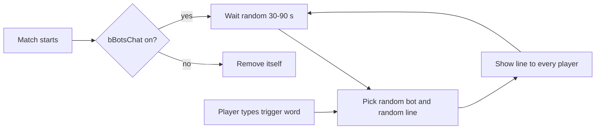
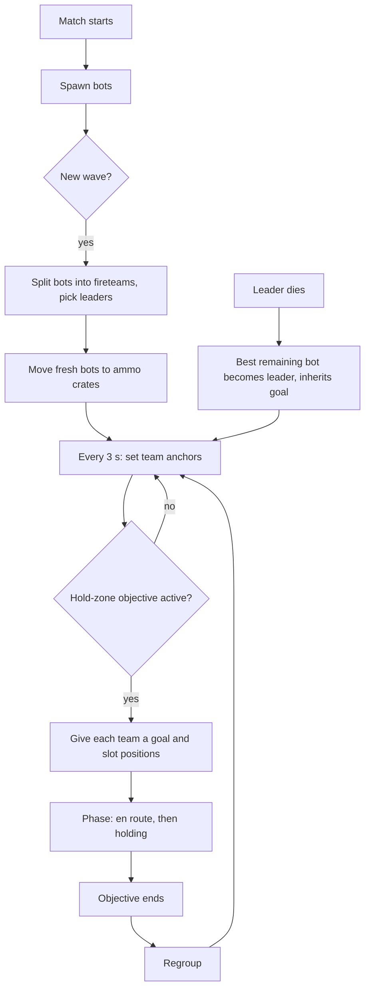
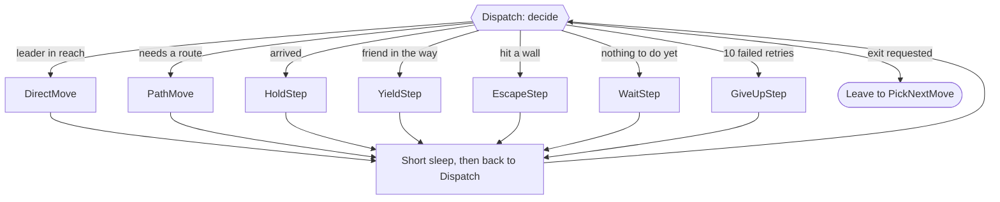
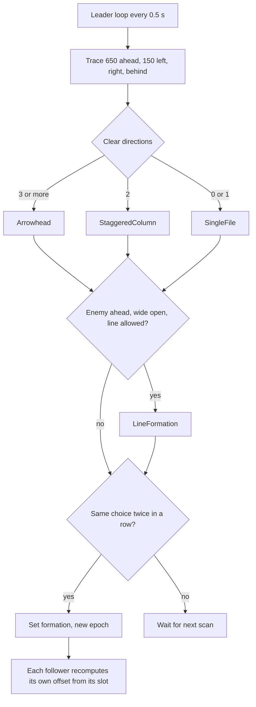
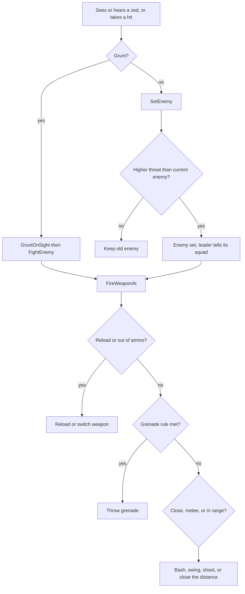
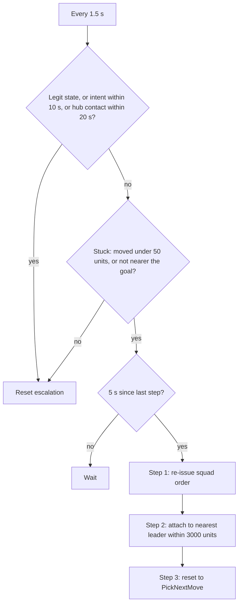
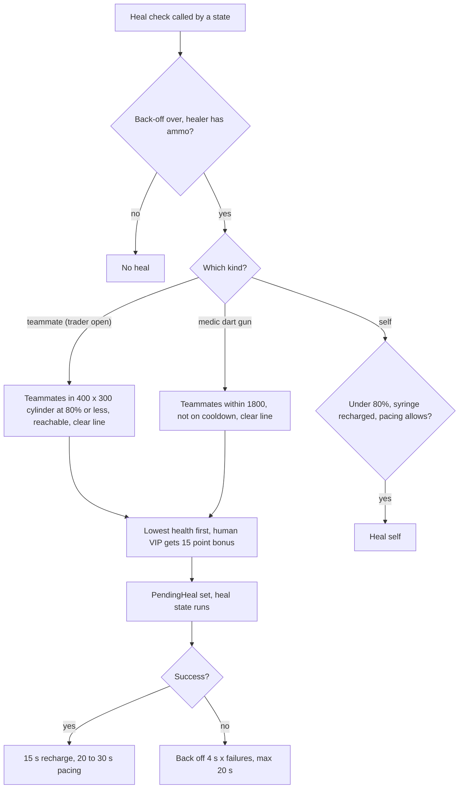
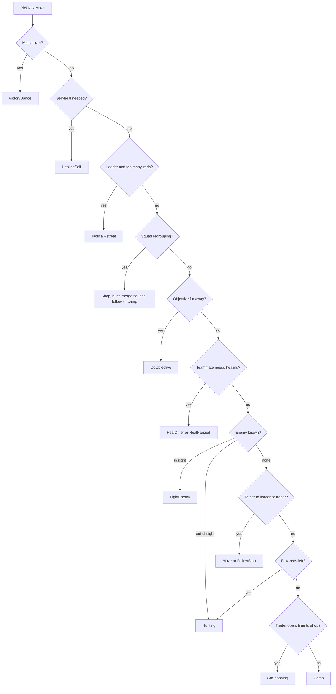
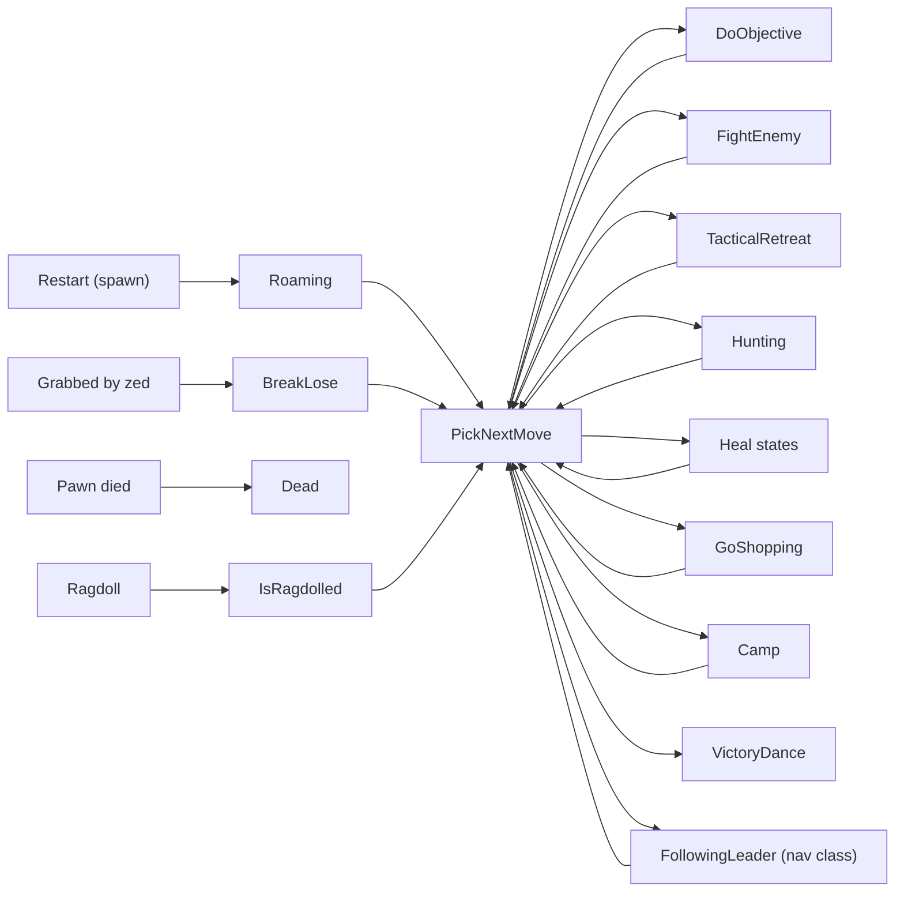

# EcholonBot architecture (hand-written, describes `playtest` at the merge into `main`, 2026-10-22)

Rewrite status: complete for all 9 files on `main`. Sections were written one at a time from the source.

This document replaces the generated v3 file and its milestone plan. It was first written against `main` at merge commit `2a04568` (PR #6, "M6") and has since been updated for PR #7 and the `playtest` branch work merged into `main` on 2026-10-22: skip-trader vote collector, ammo-crate spawn spread, leftover-zed hunt orders, eased aim, bot scoreboard avatars, the `EcholonBot_N(Name) KEY k=v` log format, and playtest mode (`EcholonSpectatorPC`). Later changes on `playtest`: remote shop, playtest trader skip, and the spectator camera controls (free fly, orbit, wheel zoom) that now also serve normal play.

Note for the build kit: the old header said this file is generated by the local agent kit's docgen. Re-running docgen will overwrite this hand-written version.

## File count

`Classes/` has **20** `.uc` files: the 9 from M6 plus `EcholonVoteCollector.uc` (skip-trader vote), `EcholonSpectatorPC.uc` (playtest mode) four navigation helpers, `EcholonNavMeter.uc`, `EcholonNavBudget.uc`, `EcholonNavScan.uc` and `EcholonNavGrid.uc`, `EcholonZonePlanner.uc` (zone list and zone hold), and four survey files: `EcholonNavDump.uc` (node and link dump), `EcholonSurveyGrid.uc` (the tile map), `EcholonSurveyBot.uc` (the exploring bot) and `EcholonSurveyLeads.uc` (the pass 2 lead list).

## Class chain

| Class | Extends | File | Lines |
|---|---|---|---|
| EcholonMut | KFMutator | `EcholonMut.uc` | 3883 |
| EcholonFollowNavBase | AIController | `EcholonFollowNavBase.uc` | 2727 |
| EcholonBotBase | EcholonFollowNavBase | `EcholonBotBase.uc` | 5355 |
| EcholonBotLogic | EcholonBotBase | `EcholonBotLogic.uc` | 1776 |
| EcholonBot | EcholonBotLogic | `EcholonBot.uc` | 2016 |
| EcholonWeaponInfo | Object | `EcholonWeaponInfo.uc` | 60 |
| EcholonChat | BroadcastHandler | `EcholonChat.uc` | 299 |
| EcholonBroadcastHandler | BroadcastHandler | `EcholonBroadcastHandler.uc` | 52 |
| EcholonInventoryManager | KFInventoryManager | `EcholonInventoryManager.uc` | 281 |
| EcholonSpectatorPC | KFPlayerController | `EcholonSpectatorPC.uc` | 63 |
| EcholonVoteCollector | KFVoteCollector (within KFGameReplicationInfo) | `EcholonVoteCollector.uc` | 86 |
| EcholonNavMeter | Object | `EcholonNavMeter.uc` | 129 |
| EcholonNavBudget | Object | `EcholonNavBudget.uc` | 121 |
| EcholonNavScan | Object | `EcholonNavScan.uc` | 107 |
| EcholonNavGrid | Object | `EcholonNavGrid.uc` | 187 |
| EcholonZonePlanner | Object | `EcholonZonePlanner.uc` | see `docs/SYMBOLS.md` |
| EcholonNavDump | Object | `EcholonNavDump.uc` | 175 |
| EcholonSurveyGrid | Object | `EcholonSurveyGrid.uc` | 440 |
| EcholonSurveyBot | AIController (not in the bot class chain) | `EcholonSurveyBot.uc` | 1412 |
| EcholonSurveyLeads | Object | `EcholonSurveyLeads.uc` | 377 |

Contents: [EcholonWeaponInfo](#echolonweaponinfo-echolonweaponinfouc), [EcholonBroadcastHandler](#echolonbroadcasthandler-echolonbroadcasthandleruc), [EcholonInventoryManager](#echoloninventorymanager-echoloninventorymanageruc), [EcholonChat](#echolonchat-echolonchatuc), [EcholonVoteCollector](#echolonvotecollector-echolonvotecollectoruc), [EcholonSpectatorPC](#echolonspectatorpc-echolonspectatorpcuc), [EcholonMut](#echolonmut-echolonmutuc), [EcholonFollowNavBase](#echolonfollownavbase-echolonfollownavbaseuc), [EcholonNavMeter](#echolonnavmeter-echolonnavmeteruc), [EcholonNavBudget](#echolonnavbudget-echolonnavbudgetuc), [EcholonNavScan](#echolonnavscan-echolonnavscanuc), [EcholonNavGrid](#echolonnavgrid-echolonnavgriduc), [EcholonZonePlanner](#zone-list-echolonzoneplanner), [survey mode, node dump and bot trace](#survey-mode-node-dump-and-bot-trace). [EcholonBotBase](#echolonbotbase-echolonbotbaseuc). [EcholonBotLogic](#echolonbotlogic-echolonbotlogicuc). [EcholonBot](#echolonbot-echolonbotuc).

Sections below follow this order of writing: small files first, then the mutator and navigation, then the bot brain (Base, Logic, Bot).

---

## How to use this document (for AI agents and new contributors)

Read in this order, stop as soon as you know where to work:

1. **This section**: pick the row in the task table below.
2. **That class's section** in this file: plain-English block for intent, then the technical part.
3. **`docs/SYMBOLS.md`** (generated by `python docs/gen_symbols.py --ref origin/main`): every function, state and label with its line number, so you can read just that range of the `.uc` file instead of the whole file. Line numbers are only valid for the source it was built from; regenerate after any edit or branch switch.
4. Only then open the `.uc` file, and read the range, not the file (EcholonBotBase is 5355 lines).

### Where things live (layers, top is closest to the game)

| Layer | File | Owns | Never does |
|---|---|---|---|
| Commander | `EcholonMut.uc` | bot spawning, fireteams, ranks, anchors, squad orders and slots, wave and objective tracking, game-rule tweaks, console commands, config | move a bot |
| Brain | `EcholonBot.uc` (18 states, `PickNextMove` hub) | which state the bot is in and the latent steps of each state | low-level helpers (those are in Base) |
| Decisions | `EcholonBotLogic.uc` | heal decisions, watchdog escalation, grunt movement intent, move evaluation | run long states or latent steps; it has no states |
| Toolkit | `EcholonBotBase.uc` | seeing, aiming, firing, reload, grenades, pathing, shopping, formation maths, squad helpers, audit log | enter long-running states on its own (it has none) |
| Locomotion | `EcholonFollowNavBase.uc` | one leader-following episode: direct move, route, stuck, yield, escape | decide the bigger plan: it only reports status upward |
| Support | `EcholonInventoryManager`, `EcholonWeaponInfo`, `EcholonChat`, `EcholonBroadcastHandler` | backpack rules, price cards, banter, chat hook | |

Single-writer rules: only the mutator changes ranks, fireteams, squad orders and `SquadLeader`. Only `EcholonFollowNavBase` writes the `Follow*` fields. The bot's state is changed by `GotoState` in Bot and Base only. Bots talk to the mutator through its public functions (`GetBotObjective`, `GetSlotLocation`, `IsSquadInObjectivePhase`, `BroadcastSpottedEnemy`, `FindNearestActiveLeader`, `MoveSquadMembers`, `ReissueSquadOrder`, `RequestLeaderDemotion`, `RegisterRangedHealTarget`, and similar).

### Task table: "I want to change X"

| Task | Start here | Notes |
|---|---|---|
| Number of bots, perks, names, difficulty, cheats, healing settings | `EcholonMut` config block in `PostBeginPlay`, constants at top | Bump `CUR_CONFIGVER` when changing defaults or the ini will not update |
| Console command | `EcholonMut.Mutate` | Standalone or admin only |
| Fireteam size, group count, anchors (ahead, behind, flank) | `EcholonMut` constants and `UpdateMacroWaypoints` | |
| Leader dies, promotions | `EcholonMut.HandleFireteamCasualty`, `EvaluateRegroupEntries` | `OnBotKilled` has no caller on main |
| Objective (hold zone) behaviour, slots, regroup | `EcholonMut.SetHoldObjective`, `SampleSquadSlots`, `EvaluateSquadPhase` | Bot side: `DoObjective` and `PickNextMove` in `EcholonBot` |
| Zed count per wave | `EcholonMut.CheckWave` | |
| Which weapon a bot holds | `EcholonInventoryManager.GetBestWeapon` | |
| What a bot buys | `EcholonBotBase.GetBestBuy`, `ProcessPurchase`, `PickFavorite` | State side: `GoShopping` in `EcholonBot` |
| When and how a bot shoots, reloads, bashes | `EcholonBotBase.FireWeaponAt`, `HandleWeaponManagement` | State side: `FightEnemy` |
| Effective range per weapon type | `EcholonBotBase` defaultproperties, `GetWeaponEffectiveRangeUU` | |
| Which enemy a bot picks | `EcholonBotBase.SetEnemy`, `GetEnemyThreat`, `PickNextEnemy` | |
| Grenades | `EcholonBotBase.ShouldThrowGrenade`, `SLGrenadeCheck` | State `GrenadeTarget` in `EcholonBot` |
| Formation shape and spacing | `EcholonBotBase.ScanRoomForFormation`, `GetFormationBase`, `ComputeSlotOffset` | |
| Retreat trigger | `EcholonBotBase.ShouldTacticalRetreat`, `SLDecisionLoop` | State `TacticalRetreat` in `EcholonBot` |
| Bot walks into walls, gets stuck while following | `EcholonFollowNavBase` (watchdog, `FollowOnStuck`, yield, escape) | Tunables are in its defaultproperties |
| Bot gets stuck while not following (roaming, objective) | `EcholonBotBase.Tick` move processing, `NotifyHitWall`, `NotifyBump`; watchdog in `EcholonBotLogic` | |
| Doors | `EcholonBotBase.MarkDoorPath`, `BuildPath*` | |
| Healing (who, when, back-off) | `EcholonBotLogic.CheckShouldHealMate`, `CheckMedicGunHeal`, `CheckMedicWeaponHeal`, `CheckShouldSelfHeal`, `HealFail`, `HealSuccess` | Heal states in `EcholonBot` run the action |
| Bot is frozen or loops in one state | `EcholonBotLogic.IdleWatchdog` (escalation steps), audit lines `WD_IDLE`, `WD_FIRE`, `STATE_EXIT`, `DWELL_TOTAL` | |
| Where a follower stands, how it reacts to its leader | `EcholonBotLogic.UpdateGruntOffset` (timer `CheckGrabbed`) | |
| When a follower stops following (shopping, objective) | `EcholonBotLogic.FollowCheckExit` | |
| New bot state | add the state in `EcholonBot`, enter it from a rule in `PickNextMove.PickMove` (priority order matters), end it with `PickCombatStyle()`, call `AuditStateEntry`/`AuditStateExit`; add it to the watchdog's legit-state list in `EcholonBotLogic.IdleWatchdog` if it legitimately lasts long | See the `EcholonBot` section state index |
| Priority of one behaviour over another (heal vs fight vs shop) | `EcholonBot` `PickNextMove.PickMove` | |
| Heal action itself (animation, range, ammo cost) | `EcholonBot` states `HealingSelf`, `HealOther`, `HealRanged` | |
| Grab escape | `EcholonBot` state `BreakLose`, `EcholonBotBase.TryBreakFree`, `ForceBreakGrapple` | |
| New squad behaviour | rank loop in `EcholonBotBase` (`SLDecisionLoop`), data in `EcholonMut` | Check the main caveat in the Base section first |
| Bot scoreboard pictures | `EcholonMut.AvatarRequest`, `AvatarDownloadDone`, `AvatarSetEntry` | Needs the local avatar server; `bBotAvatars` and `AvatarServerPort` in config |
| Chat lines, chat timing | `EcholonChat` config (`KFEcholonChat.ini`) | |
| Map survey (tile grid, how survey bots walk, drops, stuck handling) | `EcholonSurveyBot` (`SurveyTick`, `StuckFound`, `HiddenFound`, `TransferTo`), `EcholonSurveyGrid`; start and end in `EcholonMut.SurveyBegin`, `SurveyCheck`, `SurveyFinish` | Survey bots never use the bot nav code. See "Survey mode, node dump and bot trace" |
| Bot position and route trace, node dump (`TRACE_`, `NAVDUMP_` lines) | `EcholonBotBase.NavTraceTick`, `NavTraceRoute`; `EcholonNavDump`, `EcholonMut.NavDumpBegin` | Only runs when `bNavTrace` is on |

### Debugging hints

- Every bot log line goes through `EchelonLog` and reads `[EcholonAudit] EcholonBot_3(Widow) KEY name=value ...`. The tag comes from `LogTag()` in `EcholonFollowNavBase`: `EcholonBot_N` plus the in-game name without the `[rank]` tag, spaces as `_`. The mutator's lines start with `[EcholonAudit] [Mut]`. Look them up in the `KFGame/Logs` log file.
- Naming convention for new logs: call `EchelonLog("<SYSTEM>_<EVENT> name=value ...")`. The key is uppercase and its prefix names the system (`NAV_`, `NAV2_`, `HUB_`, `TETHER_`, `REGROUP_`). Do not repeat the bot name in the message. `kit/tools/log_reader.py` reads the source, so new keys need no update there. The `TRADER_ROAM*` lines are the exception: they use a plain `log` with `LogTag()`.
- Follow-locomotion lines are `NAV_*` keys: `NAV_STUCK` (with `node=`; the non-follow ladder in `EcholonBotBase.NavProgressCheck` also logs `NAV_STUCK level= state=`, `NAV_RECOVER level= ok=`, `NAV_BLOCKED`, `NAV_TELEPORT`), `NAV_LADDER`, `NAV_STRIKE`, `NAV_PATH_RELAX`, `NAV_TRAIL`, `NAV_PATH_OK` (now logs `crumb=`), the nav cost lines `NAV_COST`, `NAV_UNIT_COST`, `NAV_BENCH`, the link scan lines `NAV_SCAN_START`, `NAV_SCAN_BAD`, `NAV_SCAN`, the lava grid lines `NAV_GRID_BOT`, `NAV_GRID_BEND`, `NAV_GRID_SUSPECT`, `NAV_GRID_MAP`/`NAV_GRID_ROW`, `NAV_TELEPORT_WAIT` and the per-tick movement lines `NAV_ACCEL_NODE`, `NAV_ACCEL_LEADER`, `NAV_ACCEL_ESCAPE`, `NAV_ACCEL_YIELD`. Entering the hub logs `HUB_ENTER from=<state>`; a spawn fix logs `SPAWN_NUDGE status=nudging|settling`; crate relocation logs `SPAWN_SPOT` and `SPAWN_SPOT_REJECT`.
- A bot shows the KF2 logo instead of a picture: check the avatar server is running (look in `KF2-Avatars.log` for the requests) and read the `AVATAR_FAIL` lines (`kit\tools\log_reader.py --sample AVATAR_FAIL`).
- Audit lines are rate-limited (see `AuditRateLimit`), so a missing line does not prove nothing happened.
- Before assuming a function runs, search for its callers: several functions on main have no caller (listed in the sections as "no caller on main").
- Some code carries `// @STUB(Mx)` comments left over from the build kit. They do not mean the code is missing.

## EcholonWeaponInfo (`EcholonWeaponInfo.uc`)

**In plain English.** This is a price tag card for one gun. When a bot goes shopping it needs to know what a weapon costs, what its ammo costs per bullet, and which class of soldier uses it. One card is made per gun in the trader's list. Ammo is priced per bullet (not per magazine) so the bot can compare buying a few bullets against a full magazine. *(Inferred reason: bots shop with limited dosh and often top up, so a per-bullet price is the useful number.)*

A plain data holder (`extends Object transient`), one instance per weapon the bot shopping logic knows about. It has no states, timers or events.

Fields: `WeaponClass`, `Perk` (the weapon's first perk class), `AIRating`, `BuyPrice`, `AmmoPricePerMag`, `SecondaryAmmoMagSize`, `SecondaryAmmoMagPrice`, `PricePerBullet[2]` (primary, secondary), `bCanSell`.

`InitInformation(Def, ClassName)` fills it from a `KFWeaponDefinition`: it loads the weapon class from `Def.WeaponClassPath` with `DynamicLoadObject` and returns false if the definition or class is missing. `AIRating` is simply set to the buy price (so pricier means better in rating comparisons). `bCanSell` is `BuyPrice > 0`. `PricePerBullet[0]` is mag price divided by the weapon's `MagazineCapacity[0]` (the whole mag price if capacity is 0); `PricePerBullet[1]` is the secondary mag price divided by `SecondaryAmmoMagSize` (again the whole price if size is 0).

## EcholonBroadcastHandler (`EcholonBroadcastHandler.uc`)

**In plain English.** The game passes all chat messages along a line of "handlers". This one stands in the line and passes everything on untouched. It does nothing visible today; it only gives the mod a seat in that line in case it wants to read or change messages later. *(Inferred: a placeholder hook.)*

A pass-through wrapper around the game's existing `BroadcastHandler`. `SpawnBBHandle(M)` (static) spawns one, stores the mutator in `mut`, saves the game's current handler in `MainHandle`, then installs itself as `WorldInfo.Game.BroadcastHandler`.

Every override simply forwards to `MainHandle`: `UpdateSentText`, `AllowsBroadcast` (returns false if `MainHandle` is None), `Broadcast`, `BroadcastTeam`, `AllowBroadcastLocalized`, `AllowBroadcastLocalizedTeam`. It does not filter or record anything itself; it exists as a hook point in the handler chain so the mod owns a handler instance. It has no states or timers.

## EcholonInventoryManager (`EcholonInventoryManager.uc`)

**In plain English.** This is the bot's backpack. The normal backpack is built for a human with a screen, so this one drops the screen parts and adds rules the bots need: it never gives a second copy of a gun, picks the best weapon with a bit of randomness so bots do not all hold the same thing, and can hand out endless ammo and grenades if the "unlimited ammo" setting is on. Weapon choice is scored (heavier weapon groups score higher, an empty gun scores lower when an enemy is near, the gun in hand gets a small bonus so bots do not flip-flop). *(Inferred: the random factor keeps a squad's loadouts varied in use.)*

The inventory manager used by bot pawns (`extends KFInventoryManager`, `RemoteRole=ROLE_None`, `MaxGrenades=5`). It strips the human-oriented parts of the base class and adds the bots' ammo cheat.

- `AddInventory` calls the plain `InventoryManager` version, skipping KF's own checks.
- `CreateInventory` for weapons: only if `CanCarryWeapon`; refuses duplicates (`FindInventoryType`); creates through `InventoryManager`; plays the give-sound at most once per second and not in the first second of life; then calls `CheckForExcessRemoval`. Non-weapon items go to the plain base version.
- `ShowAllHUDGroups` is empty (bots have no HUD).
- `GiveInitialGrenadeCount` sets `GrenadeCount` to 231 when `EcholonMut.bBotsUnlimitedAmmo` is on, else 2; returns whether the count rose.
- `AddGrenades` with unlimited ammo pins the count at 231 and returns false; otherwise adds up to `MaxGrenades`.
- `GiveWeaponsAmmo(bIncludeGrenades)` gives ammo to every weapon that does not have infinite spare ammo, optionally adds one grenade, plays the ammo-pickup sound.
- `AddArmorFromPickup` gives max armor if the pawn is below max.
- `RemoveFromInventory` is a rewritten unlink: clears `PreviousEquippedWeapons`, `PendingWeapon` and `Instigator.Weapon` references to the item, unlinks it from the chain, and if the living pawn is left with no weapon either swaps to `PendingWeapon` or calls `SwitchToBestWeapon(true)` on the controller.
- `GetBestWeapon` skips healer and welder and weapons without ammo. Rating = `(GroupPriority + 10) * (2 + FRand())`, scaled by `InventoryGroup` (group 0 x2.5, group 1 x1.5, group 2 x1, others x0.25). With unlimited ammo it also refills both spare-ammo counts to 9999. x0.75 if the primary is empty and the controller has an enemy. The currently held weapon gets x1.15, or x0.25 when a different weapon is forced. Highest rating wins (so it is randomised per call).
- `SwitchToBestWeapon` picks the best weapon and, if different from the held one, stops firing and calls `SetCurrentWeapon`.

## EcholonChat (`EcholonChat.uc`)

**In plain English.** Makes the bots feel alive by having a random bot say a stock line ("Nice shot!") every 30 to 90 seconds. Players can turn it off in the settings file, change the lines, or type `!botchat` to hear one immediately. It is built as a chat handler so it can also watch for that trigger word in what players type. *(Inferred: the random gap stops the chatter from sounding scripted.)*

Optional bot banter, as a `BroadcastHandler` with its own config file (`KFEcholonChat`-style: `config(EcholonChat)`). Config version constant `CUR_CHAT_CONFIGVER = 2`.

Config fields: `ConfigVer`, `bBotsChat`, `PresetSentences` (array), `ChatIntervalMin`/`ChatIntervalMax`, `DebugTriggerWord`, plus four cosmetic `_Separator` strings that only label the ini sections.

Lifecycle:
- `PostBeginPlay` runs `InitConfigDefaults`. If `bBotsChat` is false the actor destroys itself. Otherwise it saves the game's current handler in `NextHandle`, installs itself as `WorldInfo.Game.BroadcastHandler`, and starts the one-shot timer `BotChatterTimer` with a random delay.
- `InitConfigDefaults` runs only when the saved `ConfigVer` differs from 2: it rewrites every field to defaults (chat on, interval 30 to 90 s, trigger `!botchat`, ten stock lines such as "Nice shot!" and "Reloading!") and calls `SaveConfig`.
- `GetNextChatDelay` returns a random value between `ChatIntervalMin` (floor 1 s) and `ChatIntervalMax` (not below the minimum).
- `BotChatterTimer` re-arms itself first, then calls `DoBotChat`, so chatter repeats for the whole match.

`DoBotChat` returns false if there are no bots (`Game.NumBots`), no `EcholonBot` controllers, or no sentences. Otherwise it picks a random `EcholonBot` and a random preset line and sends it to every `PlayerController` with `TeamMessage(botPRI, line, 'Say')`. Nothing is posted through the normal broadcast path, so the line shows only in player chat.

`CheckDebugTrigger` runs inside `Broadcast` and `BroadcastTeam`. For `Say`/`TeamSay` messages that start (case-insensitively) with `DebugTriggerWord`, it forces one `DoBotChat` and tells the sender via `ClientMessage` whether a bot spoke, no bots exist, or no sentences are configured. `ResolveSenderPC` maps the sender actor (controller or pawn) to a `PlayerController`.

All other handler methods (`UpdateSentText`, `AllowsBroadcast`, `BroadcastText`, `BroadcastLocalized`, `AllowBroadcastLocalized`, `AllowBroadcastLocalizedTeam`) forward to `NextHandle`, falling back to `super` when it is None. No states.

## EcholonVoteCollector (`EcholonVoteCollector.uc`)

**In plain English.** The stock skip-trader vote counts every player, bots included, but bots never vote, so with bots in the game the vote could almost never pass. This replacement counts humans only: the trader is skipped when every human votes yes, and any no vote fails it.

`extends KFVoteCollector within KFGameReplicationInfo`. `EcholonMut.InstallVoteCollector` (from `PostBeginPlay`) replaces `KFGRI.VoteCollector` with one unless the config flag `bBotsCountInSkipTraderVote` is set; it logs `VOTE_COLLECTOR`.

- `CountHumanVoters`: player records that are not bots and whose owner is a `PlayerController` (Echolon bots clear `PRI.bBot`, so the owner check is what tells them apart).
- `ShouldConcludeSkipTraderVote`: true when there is at least one human and either every human has voted or someone voted no.
- `ConcludeVoteSkipTrader`: the stock function with the pass rule `YesVotes >= humans`; otherwise it fails the vote and starts the stock failed-vote cooldown.

## EcholonSpectatorPC (`EcholonSpectatorPC.uc`)

Player controller for every game (playtest branch). It extends `KFPlayerController`. `EcholonMut.InitMutator` sets it as the game's `PlayerControllerClass` in every game, not only with `?Playtest=1`. All overrides sit in state `Spectating`, so a living player is unchanged. It has one transient field, `PlaytestMut`, found lazily by `GetPlaytestMut`. The camera state (`PlaytestLastWatched`, `PlaytestCamMode`, `ZoomDist`, `PlaytestBotCamStyle`) is kept across bot switches. The camera walks a dedicated bot order (`PlaytestCamBots`, in registration order) that is never shuffled; a dead bot keeps its slot, so next and previous walk every living bot in the same order. Test-only, `PlaytestCamCycleSecs` (above 0) presses "next bot" on the camera every that many seconds to prove the cycle from the log (`PLAYTEST_CAMERA_ORDER` once, then `PLAYTEST_CAMERA target= mode= manual=` per step; `bPlaytestCamCycleFirstPerson` watches in first person). Both settings default off. `manual=False` target changes only come from `PlaytestTick`/`PlayerTick` when the watched bot died or is gone.

- State `Spectating` overrides exec functions and sends them to the mutator, because `KFGameInfo.CanSpectate` rejects AI controllers and stock spectating cannot target bots. There is no automatic bot switch every 30 s any more: the camera switches only when the watched bot dies or is gone, or on a click. In playtest mode `PlaytestTick` checks this; in normal play `PlayerTick` checks once a second, only when the watched pawn is None or dead (a living human being watched is left alone).
  - `SpectateNextPlayer` (right click) calls `PlaytestStepCamera(self, 1, true)`, `SpectatePreviousPlayer` (left click) calls it with -1. A click also ends free fly.
  - Space (exec `Jump` in `Spectating`, plus a `bPressedJump` check in `PlayerTick`, debounced 0.3 s) toggles free fly: the view target is the spectator itself, camera style `FirstPerson`, WASD and mouse, starting where the camera is (`PLAYTEST_CAMERA_FREE on=1/0`). Space again returns to the last bot watched (`PlaytestLastWatched`) or the next living one.
  - `SpectateChangeCamMode` (middle click) calls `PlaytestToggleCamMode`, which cycles `PlaytestCamMode` ThirdPerson, FirstPerson, Orbit, ThirdPerson (`PLAYTEST_CAMERA_MODE mode=`). Orbit uses the stock `FreeCam` camera style (camera behind the bot, rotation from the mouse, `Camera.FreeCamDistance`). The mode is kept across bot switches (`PlaytestBotCamStyle`).
  - Mouse wheel zooms the distance in ThirdPerson and Orbit (100 to 600 uu, step 25, wheel up is closer; `PLAYTEST_CAMERA_ZOOM dist=`) through the execs `PlaytestZoomIn` and `PlaytestZoomOut`. Third person scales the `KFThirdPersonCameraMode` offsets through `KFThirdPersonCamera.SetViewOffset` from a stock 120 uu back offset. `ZoomDist` is kept across bot and mode switches.
  - Wheel binding: the wheel is weapon select for a living player, so `SetWheelBinds` (on `BeginState` of `Spectating`) rewrites the `MouseScrollUp`/`MouseScrollDown` commands in `PlayerInput.Bindings` in memory to `exec PlaytestZoomIn`/`PlaytestZoomOut` (`SPECTATE_WHEEL_BIND slots=N`). `Input.SetBind` is not used because it would `SaveConfig` and write `KFInput.ini`. `RestoreWheelBinds` and `ResetZoomCameras` run on `EndState` (respawn), on `Destroyed` and in `PlaytestQuit` (`SPECTATE_WHEEL_RESTORE slots=N`).
- `RecieveChatMessage` override: stock code adds "Spectator" in front of a spectator's message, but `GetChatChannel` already adds `<Spectator>`. The override drops the second prefix, so chat shows `<Spectator> Name: msg`.

### Known limitations and open items

1. Left Shift fast free fly (about 3x) is deferred. Left Shift is `bRun`, which already doubles spectator speed in `BaseSpectating.ProcessMove`. Scaling `SpectatorCameraSpeed` by 1.5 while `bRun != 0` in `PlayerTick` was tried and did not work in a hand test. Open.
2. If the user opens the options menu and saves key bindings while dead (spectating), the in-memory wheel commands `PlaytestZoomIn`/`PlaytestZoomOut` could be written to `KFInput.ini`.
3. The normal-play spectator flow (die, spectate, Space, middle click, wheel, click, respawn, wheel switches weapons again) has not been tested by hand yet and needs a manual check. The test runner always uses `?Playtest=1`.
4. `RemoteShop` ignores an `Enemy` that is dead or not engaged for 4 s, but a bot still defers while it keeps being hit or engaging a live enemy; such a bot can end the round as `TRADER_SKIP_MISSED`.
5. Click to switch in normal play steps through bots only, not human teammates.

## EcholonMut (`EcholonMut.uc`)

**In plain English.** This is the squad commander's office for the whole match. It creates the bots when the match starts, splits them into 2 to 4 small teams (fireteams) of about 3, and gives each team a leader. Every few seconds it decides where each team should be: team 1 sticks with the human player, teams 2 and 3 take positions ahead of and behind the player, team 4 covers a flank. On boss waves every team heads for the boss. When a map objective appears (a zone to stand in and hold), it hands each team a goal inside the zone and spreads the followers around that goal so they do not stack up. It also handles rule tweaks: bots take no friendly-fire damage, damage to bots can be scaled, extra zeds can spawn per bot, and players can change settings with console commands. The mutator itself never walks a bot; it only gives orders and the bots carry them out. *(Inferred reasons: teams of about 3 keep movement simple and give a leader to follow; the fixed anchors ahead/behind/flank spread the bots around the human so one ambush does not hit everyone; one central place for orders avoids two bots giving a team conflicting directions.)*

The mutator and the only "hub" in the mod. It spawns the bots, organises them into fireteams, hands out squad orders for the hold-zone objective, and applies a few game-rule tweaks. It extends `KFMutator`, has `config(EcholonBot)` and no states (all timing is done with timers). Log lines go through `EchelonLog` with the tag `[EcholonAudit] [Mut]` (a failed bot spawn logs `SPAWN_FAIL`); messages starting `ORDER_` are rate limited to one per 5 s.

### Config (saved in the ini, versioned by `CUR_CONFIGVER = 5`)

`PostBeginPlay` rewrites every config field to defaults and calls `SaveConfig` only when the saved `ConfigVer` is below 3. Later versions only add keys: below 4 it sets the nav stuck keys, below 5 it sets `bEnableMedicWeaponPriority` to true; each stamps its version and saves. The defaults below are the ones from the full reset. Defaults: `NumBots` 7, `BotMaxPerkLv` 25 (min stays whatever the ini holds), `BotsDamageScale` 1.0, `ZedCountScaling` 0.2, `bNoZerkerBots` true, custom names on (8 names: Alex, Reaper, Ghost, Widow, Havoc, Ranger, Blaze, Cipher), `bShowBotLevel` false, `bShowBotRole` true, `MaxBotsPerPerk` 2, `AllowedPerks` = every perk in `KFPlayerController.PerkList`, `MaxZedsForFailsafe` 3, `FailsafeActivationDelay` 3.0, heal settings `HealCylinderRadius` 400, `HealCylinderHeight` 300, `HealMinHealthPct` 60, `bEnableFastTraceHealing` true. `bRemoteShop` (default False, a missing key reads as False) is not part of the reset block; see the remote shop bullet under Boot and spawning. `MinimumBots`, `bBotsUnlimitedAmmo`, `bBotsUnlimitedCash` and `bDebugGrapple` are not reset by this block (they default to zero/false). The same holds for `bBotAvatars` (off) and `AvatarServerPort` (0 means 8765). The nav block resets with the rest: `NavGridSquads` 0 (lava grid for every squad; N = only squad N, 1 is the first; -1 = off) and `bNavGridDebug` false (log an ASCII map of the grid around squad 1's leader every 20 s as `NAV_GRID_MAP`/`NAV_GRID_ROW`). The survey and trace settings are not reset by this block and default to off or zero: `bNavTrace` (false; logs the map's path nodes and links at match start and each bot's position and route), `SurveyBots` (0 or less means 4), `SurveyMinutes` (0 or less means 60), `SurveyTraces` (0 or less means 120 traces per frame) and `SurveyBfsNodes` (0 or less means 400 search nodes per frame). URL options for one match: `?Survey=1`, `?SurveyBots=N`, `?SurveyMinutes=N` (see "Survey mode, node dump and bot trace").

**Nav redesign Stage A switch.** `bNavV2` (config, default false; `?NavV2=1` / `?NavV2=0` overrides it for one match; `CUR_CONFIGVER` is 5 and the `ConfigVer < 5` migration block only adds the key, it resets nothing). `EcholonMut` logs `NAV2_CONFIG navv2=` at match start.

### Constants

Squads: `MIN_GROUPS` 2, `MAX_GROUPS` 4, `BOTS_PER_GROUP_TARGET` 3, `VIP_ESCORT_MIN_SIZE` 2, `GROUP_DISSOLVE_SIZE` 1. Anchors: `VANGUARD_OFFSET` 2000, `REARGUARD_OFFSET` 2000, `CHOKEPOINT_LATERAL_OFFSET` 1000, `NAV_SEARCH_RADIUS` 1500, `MACRO_WAYPOINT_INTERVAL` 3.0. Squad phases: `PHASE_IDLE` 0, `PHASE_ENROUTE` 1, `PHASE_HOLDING` 2, `PHASE_REGROUP` 3. Others: `OBJ_BAIL_COOLDOWN` 8.0, `REGROUP_DURATION` 5.0, `REGROUP_HARD_TIMEOUT` 6.0, `REGROUP_SCAN_RADIUS` 5000, `WAVE_POLL_INTERVAL` 1.0.

### Data

- `Fireteams[]` (`FireteamData`: `Members`, `Leader`, `Anchor`) and `SquadOrders[]` (`SquadOrder`: leader, hold zone, goal point and nav node, slot list and slot locations, phase, start time, objective-bail stamp, per-bot node blacklist, seed angle). Index `i` is group id `i+1`.
- `ActiveBots`, `VIPController`/`AlphaCommander`, `CachedHumans` (position/velocity of living human pawns), `TraderList` (`EcholonWeaponInfo`), `PendingPromotions`, ranged-heal cooldown arrays, perk pool arrays, name pool.
- Avatars (transient): `AvatarMatchId`, and the parallel arrays `AvatarDL[]` (`KFHTTPImageDownloader`), `AvatarPRI[]`, `AvatarApplied[]`, one slot per requested bot picture.

### Timers

| Timer | Interval | Started in | Does |
|---|---|---|---|
| `PollWaveStart` | 1.0 s loop | `PostBeginPlay` | when `GRI.WaveNum` changes: `InitializePlatoon`, `RelocateBotsToAmmoCrates` |
| `CacheHumans` | 3.0 s loop | `PostBeginPlay` | refresh `CachedHumans` |
| `CheckWave` | 0.1 s loop | `MatchStarting` | wave/objective bookkeeping (below) |
| `Timer` (unnamed) | 1.0 s loop | `MatchStarting`, non-standalone only | add or remove one bot to match `NumBots`/`MinimumBots` |
| `UpdateMacroWaypoints` | 3.0 s loop | `InitializePlatoon` | re-anchor squads, promotions, regroup checks |
| `NavBenchmarkRun` | 15 s one-shot, retried every 10 s | `PostBeginPlay` | once a bot has a pawn: `NavBenchmark` on that bot (logs `NAV_BENCH`, then `NAV_UNIT_COST`), then `NavScanBegin` |
| `NavGridDump` | 20 s loop | `PostBeginPlay`, only when `bNavGridDebug` | log the grid map |
| `RemoteShopSweep` | 1.0 s loop | `CheckWave`, when the trader opens | while `bRemoteShopActive`: calls `RemoteShop` on every living bot; clears itself when the trader closes |
| `ReEnableAmmoFactories` | 10 s one-shot | `HideAllPickups` | un-hide pickups (`HideAllPickups` itself has no caller on main) |

### Navigation services

The mutator owns the shared nav objects (`NavMeter`, `NavBudget`, `NavScan`, `NavGrid`, all transient) and `RegisterBot` hands them to each bot. `Tick` closes the meter's frame (`EndFrame`, which logs `NAV_COST`). `NavScanBegin`/`NavScanStep`/`NavScanCheck` walk every `ReachSpec` once at match start (a slice per frame, paid from the budget's scan share) and record bad links in `NavScan`; `NavScanCheck` returns a result code (1 blocked, 2 no floor, 3 special, else fine) and counts traces; bad links are logged as `NAV_SCAN_BAD why=blocked|nofloor|special` (first 150 only), the total as `NAV_SCAN`. `NavGridAppliesTo(bot)` applies `NavGridSquads`.

### Boot and spawning

- `PostBeginPlay`: registers itself in the mutator chain, caches `KFGameInfo_Survival`, applies config defaults, spawns the `EcholonChat` actor once (`bChatterInit`), starts the two timers. `AddMutator` destroys a second mutator of the same class.
- `MatchStarting`: in a standalone game, spawns `NumBots` bots straight away; otherwise starts the 1 s population timer. Starts `CheckWave`.
- `AddBot`: finds a player start, spawns an `EcholonBot` there, picks its perk (`PickBotPerk`), sets the PRI perk class and id, runs `GenericPlayerInitialization` and `RestartBot`, gives starting cash, and updates the game's living player count. A bot registers itself with `RegisterBot` from the bot base class, not from here.
- Bot avatars (`bBotAvatars`, standalone only, off by default): `MatchStarting` rolls `AvatarMatchId` and logs `AVATAR_ON`. `AddBot` calls `AvatarRequest(PRI)` after the PRI id is set. It gives the bot a fake `UniqueId` (`Uid.A` 0, `Uid.B` `0x0EC00000` + `PlayerID`), then starts a `KFHTTPImageDownloader` for `http://127.0.0.1:<AvatarPort()>/avatar/<match>/<PlayerID>.png` (`AVATAR_REQUEST`). The server is `avatars/avatar_server.py`. Players do not start it by hand: `avatars/kf2_avatars_launcher.py` (built into `KF2-Avatars.exe` by `avatars/Build-AvatarsExe.bat`) runs it on `127.0.0.1:8765` in a thread, starts the game from a Steam launch option (`"<path>\KF2-Avatars.exe" %command%`) or via `steam://rungameid/232090`, logs to `KFGame\Logs\KF2-Avatars.log`, and exits when no `KFGame.exe` is left. The server keeps running whatever `bBotAvatars` says, so turning it on mid-session works. The kit's `Start-AvatarServer.bat` still starts the same server for development. It crops images from `Documents\My Games\KillingFloor2\KFGame\BotAvatars` to 128x128 and shuffles them per match; when it runs out it returns 404 and the bot keeps the KF2 logo. `AvatarDownloadDone` (the delegate does not say which downloader finished, so it checks all pending ones) calls `AvatarSetEntry`, which writes the texture into the local `KFPlayerController.AvatarList` that the scoreboard reads (`AVATAR_SET`, or `AVATAR_FAIL`).
- Playtest mode (`?Playtest=1` on the map URL, playtest branch only): the human watches the bots and the run needs no input. `InitMutator` reads the options `Playtest=1`, `PlaytestWaves` (wave cap, 0 = whole match) and `PlaytestBots` (bot count for this match only), reads `SkipTrader=1` into `bPlaytestSkipTrader` (only read with `Playtest=1`), logs `PLAYTEST_START` (now with `skip_trader` and `remote_shop`) and starts the 1 s `PlaytestTick`. Each tick (`PlaytestCheckWaveEnd` runs before the human lookup, so wave end is checked even with no human):
  - Before the match begins, `PlaytestAutoReady` marks the human ready (`PLAYTEST_READY`, once).
  - `PlaytestMakeSpectator` takes the human's pawn away and makes them a spectator, and runs again if the game gives a new pawn (`PLAYTEST_SPECTATE`).
  - `PlaytestStepCamera` puts the camera on a living bot (`PLAYTEST_CAMERA`). The tick calls it when the watched bot is dead or gone; there is no timed rotation. `PlaytestToggleCamMode` cycles the camera mode (`PLAYTEST_CAMERA_MODE`). The other camera controls are in the EcholonSpectatorPC section.
  - `PlaytestCheckStuckWave`: if 3 or fewer zeds stay alive with an unchanged count for 180 s, it logs where they are (`PLAYTEST_STUCK_WAVE`) and kills them.
  - `PlaytestCheckWaveEnd` logs `PLAYTEST_WAVE_END` when the trader opens or the match ends (result `won` or `wipe`). It logs `PLAYTEST_DONE` on wipe, victory or when `PlaytestWaves` is reached, then `PlaytestQuit` exits the game 5 s later. A wipe is also declared when no bot is alive for 5 s during a running wave (not trader time; `PlaytestZeroSince`): the human spectator does not count as a survivor and the engine never flags the match over, so the defeat menu stayed. This sets `Over`, so `PLAYTEST_WAVE_END result=wipe` and `PLAYTEST_DONE reason=wipe` are logged.
  - `PlaytestCheckTraderSkip` (after `PlaytestCheckWaveEnd`, only with `SkipTrader=1`): while the trader is open with more than 5 s left, it waits until every living bot has `ShoppedWave == WaveNum` (dead bots are ignored, a respawned bot counts again once alive). If any bot is in state `DonatingMoney` it then waits up to 20 s after the last bot finished. Then it calls `KFGRI.VoteCollector.SkipTraderTime()` (stock path, no vote; cuts `RemainingTime` to `TimeAfterSkipTrader` = 5). Without a `VoteCollector` it sets `RemainingTime` and calls `KF.SkipTrader(5)`; this fallback is never reached in practice. It logs `TRADER_SKIP wave= bots= waited_share= saved=`, or `TRADER_SKIP_MISSED wave= pending=` (the bots that last held it up) if the trader closes without a skip. Measured on KF-BioticsLab with 7 bots: `SHOP_REMOTE` for all bots the second the trader opens, and `TRADER_SKIP` saved 69 s per round.
  - Every 10 s it logs `PLAYTEST_HEARTBEAT`.
  - VIP anchor: while the human spectates (no human alive), `GetVIPController` uses `PickLeaderAnchor`: the current anchor while it is a living squad leader, else the first living group leader. The stand-in stays a squad leader (no `CAPTAIN` raise), and a group 0 leader that is the stand-in VIP gets no anchor (`VIP_CHANGE` on change).
  - Log keys: `PLAYTEST_START`, `READY`, `SPECTATE`, `CAMERA`, `CAMERA_MODE`, `CAMERA_FREE`, `CAMERA_ZOOM`, `STUCK_WAVE`, `WAVE_END`, `DONE`, `HEARTBEAT` (all prefixed `PLAYTEST_`), plus `TRADER_SKIP`, `TRADER_SKIP_MISSED`, `SHOP_REMOTE_MODE`, `SHOP_REMOTE`, `SHOP_REMOTE_DEFER`, `SHOP_WALK`, `SPECTATE_WHEEL_BIND`, `SPECTATE_WHEEL_RESTORE` (unprefixed), and `VIP_CHANGE` (unprefixed, replaces `PLAYTEST_ANCHOR`). The local runner `kit\tools\playtest_runner.py` (kit is not in the repo) launches the game with these options and reads the `PLAYTEST_` lines.
- Remote shop (`bRemoteShop` in the ini, or `?RemoteShop=1` on the map URL; `?RemoteShop=0` forces it off; works with or without `Playtest=1`): `InitMutator` stores the result in the transient `bRemoteShopActive` and logs `SHOP_REMOTE_MODE on=1 source=url|config`. When active, bots buy from where they stand (see Shopping under EcholonBotBase). `CheckWave` starts the 1 s `RemoteShopSweep` timer when the trader opens, because the bots' own picks reach P9 only after the objective, regroup and follow steps. The sweep stops itself when the trader closes.
- `RestartBot`: a hand-written copy of the game's restart sequence: pick start spot, spawn pawn, possess, default inventory, `SetPlayerDefaults`, fire `SeqEvent_PlayerSpawned` kismet events, `SetTeam`, then re-apply the bot's chosen character archetype (it must come after `SetTeam`, which resets it), then set PRI health and at least the respawn cash.
- `RemoveBot`: destroys the lowest scoring bot (random + a quarter of its dosh, minus 500 if dead, plus current health if alive).
- `RegisterBot`/`UnregisterBot`: maintain `ActiveBots`; register sets `bot.mut` and the watchdog contact stamp; unregister also calls `HandleFireteamCasualty`.
- Perks: `ResetPerkPool` builds the pool from `AllowedPerks` (Berserker removed if `bNoZerkerBots`); `PickBotPerk` picks randomly and removes a perk from the pool once `MaxBotsPerPerk` bots took it; with no usable list it falls back to `PickFallbackPerk` (random perk, not Berserker when banned).
- Names and look: `InitBotCharacter` rolls a perk level in `[BotMinPerkLv, BotMaxPerkLv]`, picks a character archetype that has a sound group and avoids ones other bots use (up to 4 retries), picks a custom name (`PickCustomBotName`, no repeats until the pool empties; falls back to the archetype name or "Horzine_Bot"), prefixes `[LvN]` and/or `[Rank]` per config, and sets the PRI name.
- `InitTraderList(L)`: builds an `EcholonWeaponInfo` per trader item; `FindWeaponByClass` looks one up. The bot base calls `InitTraderList` the first time it needs the list.
- `RespawnBots`: at trader time, sets every bot's shopping time to now, respawns dead bots, gives living ones +500 dosh.
- `NetDamage` (mutator hook): damage to a bot from a teammate becomes 0 with momentum x0.25; any other damage to a bot is multiplied by `BotsDamageScale`.
- `Mutate` console commands: `AI` (debug line for nearest bot, anyone), and for standalone games or admins: `Help`, `SetNumBots`, `SetMinBots`, `SetBotMinLv`, `SetBotMaxLv`, `SetScaleZedCount`, `SetNoZerker`, `SetBotsInfAmmo`, `SetBotInfDosh`, `SetUseCustomNames`, `SetBotsLevel`, `SetBotRole`, `SetBotAvatars`, `SetBotDamageScale`, `SetBotChat`, `BotTalk`. Each saves the config and replies to the sender.
- `PickRandEmote`/`ShouldDoVictoryDance` (5 s global gap between dances) serve the bots' emote code.

### Fireteams and ranks

- `InitializePlatoon` (each new wave): prunes dead bots, shuffles, picks the group count (`bots / 3`, clamped 2 to 4), deals bots round-robin into `Fireteams`, makes the first of each group `SQUAD_LEADER` and the rest `GRUNT`, then raises the alpha commander to `LIEUTENANT` and the VIP to `CAPTAIN` (never a stand-in VIP, which is always a squad leader), calls `SyncSquadLeaders`, re-rolls names/archetypes (`InitBotCharacter`), starts the macro-waypoint timer, and calls `SetHoldObjective` again when an objective is active.
- `SyncSquadLeaders`: sets each member's `SquadLeader` and gives every follower a slot index and the follower total through `FollowSetSlot`.
- `UpdateMacroWaypoints` (3 s): prunes bots, runs the promotion queue, expires ranged-heal cooldowns, replaces a dead VIP, runs `EvaluateRegroupEntries`, then assigns each leader an `AssignedAnchor` and copies it to the followers (`PropagateAnchorToFollowers`). On a boss wave with a pawn over 5000 HP (`FindBossPawn`) every leader's anchor is the boss. Otherwise group 0 follows the VIP (no anchor while the trader is open, and none if that leader is the stand-in VIP itself, in normal play too), group 1 anchors 2000 units ahead of the VIP, group 2 2000 behind, group 3 at a flank point 1000 units to the VIP's side. Anchors are the nearest nav point to the projected position (`FindNearestNavPoint`, closest rather than first hit).
- `GetVIPController` = the first living human player's controller. While no human is alive (dead, or spectating in playtest mode) a living bot squad leader picked by `PickLeaderAnchor` stands in and stays a squad leader; the VIP returns to the human on respawn (`VIP_CHANGE` on change).
- Command score = kills x 10 + health. `FindBestCandidate` takes the highest, `FindExpendableMember` the lowest non-leader.
- `OnBotKilled` queues a `PromotionRequest` when an officer (squad leader, lieutenant, captain) dies, and runs VIP succession if it was the VIP. `ProcessPromotionQueue` fills requests from living grunts (1 per tick, 2 after wave 5). Nothing on main calls `OnBotKilled`, so this queue is never fed; leaders are replaced by `HandleFireteamCasualty` and `EvaluateRegroupEntries` instead.
- `HandleVIPSuccession`: just calls `GetVIPController` (no best-scoring bot, no alpha commander, no demotion).
- `HandleFireteamCasualty` (from `UnregisterBot`): removes the member; if it led, the best remaining member becomes leader (`SQUAD_LEADER`, stuck state reset, `InheritSquadOrder`), otherwise the squad order's leader is cleared. Then `ConsolidateFireteams` and re-sampling of slots.
- `DemoteGroupLeader`/`RequestLeaderDemotion`: used for a stuck leader; hands leadership to the best other member.
- `ConsolidateFireteams`: if group 0 has fewer than 2 members it pulls an expendable bot from the nearest group that has more than 2; any group of exactly 1 member is dissolved into the nearest group with at least 2 members. Ends with `SyncSquadLeaders`.
- `ReassignBotToGroup`, `GetGroupLeader`, `GetGroupSize`, `GetFollowerIndex`, `GetFollowerBySlot` are the lookup/move helpers.
- `BroadcastSpottedEnemy(group, pawn)`: gives that enemy to every group member without a live enemy (except the leader) via `SetEnemy`.
- `InitialRelocate` (once, in the match-start tick right after the bots are created; guarded by `bInitialRelocated` because `MatchStarting` can fire twice): sets `bForceRelocate` and calls `RelocateBotsToAmmoCrates`, so every bot starts alone on an ammo crate and has to find its squad leader by itself.
- `RelocateBotsToAmmoCrates` (also right after `InitializePlatoon` on each wave, where it only moves bots still `bJustSpawned`): puts each bot on a random ammo pickup factory with fewer than `RELOCATE_MAX_PER_CRATE` (3) people, counting living humans within 300 units of a crate first; when every crate is full it takes the least crowded one. Each spot comes from `PickRelocateSpot` (8 tries on an 80 to 160 unit ring; `RelocateSpotOk` needs floor within 160 units below, a clear pawn cylinder, and a nav point within 400 units that is visible and on the same floor; else the nearest `PathNode`). Logs `SPAWN_SPOT`/`SPAWN_SPOT_REJECT` too. Logs `SPAWN_SPREAD bot= crate= occupancy=`. `SetupSquadSpawns`/`SpawnSquadAt`/`SpawnBotWithRank` (leader + 3 grunts per squad) exist but have no caller on main.

### Wave and objective (`CheckWave`, 0.1 s)

1. If a new wave flag is set and the game state is `TraderOpen`, run `RespawnBots`.
2. When the wave number changes, store it and flag a new wave; if `ZedCountScaling > 0` and the wave has more than 4 zeds, multiply `WaveTotalAI` by `1 + NumBots x ZedCountScaling` and update the GRI counters.
3. When `GRI.CurrentObjective` changes: a `KFMapObjective_DoshHold` calls `SetHoldObjective`; anything else ends an active objective. While active, it ends when `HoldVolume.GetProgress() >= 0.999`.
4. `UpdateHuntOrders` (also ends an active zone, `EndZone('hunt')`).
5. `EvaluateSquadPhase`.

Zone flags: `bZoneActive` is set by `ZoneCommit` when `bZonePlanner` picks a zone (see Zone hold). `HasHoldGoals()` returns `bObjectiveActive || bZoneActive`; the bots use it where they used to read `bObjectiveActive`. `SetHoldObjective` ends any active zone first, and an ended objective with more than 15 zeds left queues a new zone pick.

- `SetHoldObjective(volume)`: collects nav points inside the volume (`ValidPoints`). If any, for each squad it clears the blacklist and bail stamp; a squad whose `Fireteams[i].Leader` is alive gets the nearest valid point as goal, phase `ENROUTE`, a random seed angle, and its slots are sampled; it also sets `SquadOrders[i].Leader` and clears every bot's cached `ObjectiveGoal`. A squad with no leader goes `IDLE`. Logs `HOLD_START squads= points=`, `HOLD_SKIP squad= reason=NoLeader`, `HOLD_EMPTY volume=` (no points). `InitializePlatoon` calls it again when it ends with an objective active (`HOLD_REISSUE reason=PlatoonRebuilt squads=`), because the zone can start on the same tick as the wave, before squads exist.
- `EndObjective`: clears orders, releases slots, puts squads that still have members into `REGROUP`, and calls `FinishObjective` on every bot. Logs `HOLD_END squad= phase=`.
- `EvaluateSquadPhase`: `ENROUTE` becomes `HOLDING` once the leader and at least one follower are inside the zone (or within 96 units of the goal when there is no zone); `HOLDING` falls back to `ENROUTE` when the leader leaves. Logs `HOLD_PHASE squad= phase=HOLDING|ENROUTE` on changes, and `LogHoldTravel` logs `HOLD_TRAVEL squad= phase= dist= inside=` every 5 s (leader distance to goal). Known: a squad that cannot path may never arrive (leader walking problem).
- `SampleSquadSlots(group)`: places up to 4 candidate slots on a 96-unit circle around the goal (starting at the squad's seed angle), drops ones outside the zone or more than 50 units above/below the leader, then greedily keeps the candidates farthest from the goal and from each other. `ReleaseSquadSlots` clears them. `GetSlotLocation(bot)` returns the slot for the bot's follow index.
- `UpdateHuntOrders` (at most once per second): when no objective is active, the match is running, the trader is closed, it is not the boss wave and `GRI.AIRemaining <= 15` with a living zed, it sets `bHuntOrderActive` and gives every living squad leader a goal: the nav point nearest the zed closest to that leader, skipped when that zed is already within 1200 units (combat sees it). Bots then use the normal objective path (`PickMove` P5, `DoObjective`, follow), so the whole squad follows its leader. When the condition ends it clears the goals, unless a hold objective is active (then the squad goals stay). Logs `HUNT_ORDER_START zeds= remaining=` and `HUNT_ORDER_END`.
- `InheritSquadOrder`: a new leader keeps the goal unless it lies outside the zone, in which case the goal moves to the valid point nearest the new leader.
- `EvaluateRegroupEntries` (called from the 3 s timer): a squad with a dead leader gets a new one and enters `REGROUP`; a squad whose leader has no goal and has sat in `PickNextMove`, `Camp` or `Roaming` for 3 s with no zeds within 5000 units also enters `REGROUP`. `MoveSquadMembers(from, to)` merges one squad into another during regroup.
- `GetBotObjective(bot)`: the squad's goal node, else the nearest leader's goal, else a random valid point. `IsNodeBlocked`/`AddNodeBlock`: per-bot, per-squad blacklist entries that last 8 s.
- Helper queries for the bots: `GetSquadPhase`, `IsSquadInObjectivePhase`, `GetSquadStartTime`, `HasSquadGoal`, `ReissueSquadOrder`, `FindNearestActiveLeader` (nearest other leader or human within a distance), `CountZedsInRadius`, `GetObjectiveLocation`.
- Ranged healing: `RegisterRangedHealTarget(Target, Secs)` stamps a cooldown (15 s from HealRanged) for any teammate; `IsRangedHealTargetOnCooldown` and `CleanupRangedHealCooldowns` read and expire it. Medic priority reservations: `ReserveHealTarget`, `IsHealTargetReservedByOther`, `ReleaseHealReservation` (10 s, cleaned by `CleanupRangedHealCooldowns`). Config: `bEnableMedicWeaponPriority` (default true, set by the `ConfigVer < 5` migration) and test-only `BotTestMedicCount`.

### Zone list (EcholonZonePlanner)

**In plain English.** At match start the mutator builds a list of places where a squad could hold a fight: every Dosh Hold zone and every trader pod, each rated usable or not and given a reason. It writes the list to the log; step 3 (below) also makes squads hold one of the usable zones in normal waves. `EcholonZonePlanner` (`extends Object transient`) is created in `PostBeginPlay` when `bZonePlanner` is on, and `Tick` starts it (`ZoneStep`) once `NavScan.bDone`. Its `Step()` runs once per frame, one phase at a time, and is charged to the shared nav budget at `NAV_PRIO_SCAN`; it waits at most 10 busy frames.

- Phase collect: Dosh Hold volumes (`KFMapObjective_DoshHold.Encompasses` tested over all nav points), trader pods (`KFTraderTrigger`) and `KFSpawnVolume` centres. A pod within `ZoneMergeDist` of a Dosh Hold is marked `merged_into_<id>`.
- Phase flood: breadth-first walk of the nav links from the `PlayerStart`s, using a hash of 8192 slots. A map with more than 6000 nodes logs `ZONE_SKIP reason=too_many_nodes` and gets no list.
- Phase zones, one zone per frame: standing spots are picked greedily nearest the centre, at least `ZoneSpotSpacing` apart, and spots within `ZoneSpawnClear` of a spawn volume centre are dropped. A pod uses the nearest reached node outside the trigger radius, plus 150, as its centre, and grows its radius from `ZonePodRadius` to `ZonePodRadiusMax` in `ZonePodStep` steps. Entries are the nav links crossing the zone border, clustered within 400 uu; a two-way link counts once.
- Verdict, first match wins: `no_nodes`, `unreachable`, `spawn_near` (zone centre within `ZoneSpawnClear` of a spawn volume), `few_spots` (fewer than `ZoneMinSpots`), `no_entry`, `ok`.
- Settings (config, `KFEcholonBot.ini`): `bZonePlanner`, `ZoneMinSpots` 6, `ZoneSpotSpacing` 200, `ZonePodRadius` 800, `ZonePodRadiusMax` 1400, `ZonePodStep` 200, `ZoneSpawnClear` 300, `ZoneMergeDist` 800, and for the hold `ZoneMinDist` 1500, `ZoneMaxDist` 4000, `ZoneWideDist` 6000 (added with `ZoneConfigVer` 2), and for the hold timer `ZoneHoldSecs` 90, `ZoneArriveTimeout` 60, `ZoneMinHoldSecs` 45, `ZoneIdleSecs` 15 (added with `ZoneConfigVer` 3). `ZoneMinHoldSecs` is clamped to at most `ZoneHoldSecs`. Defaults are written once and tracked by `ZoneConfigVer`, separate from `ConfigVer`, which is not bumped. A zero value reads as the default.
- Logs: `ZONE_LIST_START dosh= pods= spawns= nodes=`; `ZONE_FLOOD reached= nodes= frames=`; `ZONE_LIST id= src=dosh|pod name= at= radius= spots= entries= usable= why= nearspawn= dropped=` (merged pods also `into=`); `ZONE_ENTRY zone= idx= at= links=`; `ZONE_LIST_DONE map= usable= total= frames= secs= reached=`; `ZONE_SKIP reason=too_many_nodes`.
- Zone list changes in step 3: `SpawnNear` uses a per-zone prefiltered spawn list; a trader pod merged into a Dosh Hold zone lends its reached nodes to it.
- Test results (1 wave, 7 bots): BurningParis 10 usable of 22 zones, Dystopia2029 8 of 11, each built in under 1 s.

#### Zone hold (step 3)

**In plain English.** With `bZonePlanner` on, the squads now go and stand in one of the usable zones during normal waves. At the start of each wave one zone is picked at random, not too close and not too far from the squads. The first squad takes the middle, the second squad takes the main entrance, and any other squad stands between them. A real Dosh Hold objective always takes priority. A zone is held for up to 90 s after the first squad arrives; if no squad arrives within 60 s the zone is abandoned. When the hold timer or the no-arrive timeout fires, a new zone is picked (if more than 15 zeds remain) or the hunt order starts (15 or fewer). The hunt order no longer ends a holding zone at once: it waits until the hold has lasted at least 45 s, unless no squad member has had a living zed as its Enemy for `ZoneIdleSecs` (15 s), in which case the zone ends early and the hunt starts. The zone also ends if the wave ends, the trader opens or a boss appears.

- Pick: at each normal wave start (`PollWaveStart`, after `InitializePlatoon`) `ZoneQueuePick` sets a pending pick. `ZonePickStep` (timer 0.5 s) takes the average position of the living squad leaders and looks for usable zones 30 to 80 m away (`ZoneMinDist` 1500, `ZoneMaxDist` 4000 uu). If none, it widens to `ZoneWideDist` 6000, then falls back to the nearest usable zone. The choice is fully random. The last 2 zones used (`RecentZones`, kept across waves) are skipped; if that leaves nothing it retries without the exclusion. One route is checked from the first living leader with `EcholonBot.ProbeRoute` (runs `FollowFindWalkablePath` and restores `RouteCache`, `FollowSpecialSpecs`, `RouteGoal` and `RouteDist`; one search token per probe). After 3 failed routes it logs `ZONE_NONE reason=no_route` and retries after 10 s. If no zone qualifies it logs `ZONE_NONE reason=no_usable` and the old VIP anchors stay.
- Commit: `ZoneCommit` sets `bZoneActive`, `ActiveZoneId` and the zone centre and radius. `ZoneDeal` then deals roles with `EcholonZonePlanner.DealSpots`: squad 1 is Core (spots nearest the centre), squad 2 is Entry (spots nearest the primary entry, the entry that most spawn volumes face), squads 3 and up are Reserve (midway). Spots come only from the zone's own `Spots`. The result is stored in `SquadOrders`: `GoalNav` and `GoalPoint` are the leader spot, `SlotLocs` the follower spots, plus `Role`. Followers use `GetSlotLocation`.
- Bot side: `HasHoldGoals()` is `bObjectiveActive || bZoneActive` and replaces `bObjectiveActive` in the bot-side reads (`EcholonBot` priority 5 and `PickStyle`, the `EcholonBotLogic` follow gate, and the human lieutenant objective location in `EcholonBotBase`). A zone asks for its goal at each pick, like a hunt order.
- Priority: a real Dosh Hold objective always wins (`SetHoldObjective` calls `EndZone('objective')`). If the objective ends mid-wave with more than 15 zeds left, a new pick is queued (`reason=objective_end`).
- End: `EndZone(reason)` clears goals, slots and roles and calls `FinishObjective` on every bot. Reasons: `hunt` (from `UpdateHuntOrders`; deferred while the hold has lasted less than `ZoneMinHoldSecs` unless the squad is idle (`hunt_idle`); no new zone for the rest of that wave—`bZoneNoMoreThisWave` is set only when the hunt really starts), `hunt_idle` (no squad member had a living zed as its Enemy for `ZoneIdleSecs`; starts the hunt early), `timer` (hold lasted `ZoneHoldSecs` since first arrival), `no_arrive` (no squad arrived within `ZoneArriveTimeout`), `trader`, `objective`, `boss`, `wave_end`. After `timer` or `no_arrive`, a new zone is picked if more than `HUNT_ORDER_MAX_ZEDS` (15) zeds remain (the `no_arrive` zone is barred from that next pick); otherwise the hunt order starts.
- While a zone is active: `UpdateMacroWaypoints` sets each leader's anchor to its role spot (no VIP-facing anchors). `EvaluateSquadPhase` uses `ZoneInside` (2D within radius + 100 uu, height window 350 uu), and a lone leader may arrive. A zone leader's death re-deals (`ZONE_REDEAL reason=leader`) instead of `REGROUP`. `SampleSquadSlots` does nothing.
- Settings note: the `ZoneConfigVer` migrations 1 and 2 write the `Zone*` defaults (version 1 also sets `bZonePlanner=True`) while `ZoneConfigVer` is below them (`ConfigVer` is untouched). Migration 3 only adds `ZoneHoldSecs`, `ZoneArriveTimeout`, `ZoneMinHoldSecs` and `ZoneIdleSecs` and keeps every other value. An "off" test run with the playtest runner must pass `--ini ZoneConfigVer=2` together with `--ini bZonePlanner=False`; otherwise `bZonePlanner` is switched back on.
- Logs: `ZONE_PICK zone= src= dist= band=30-80|120|nearest tries= recent= reason=wave_start|objective_end|timer|no_arrive`; `ZONE_SKIP reason=objective|trader|boss|hunt` (before each silent pick cancel in `ZonePickStep`); `ZONE_NONE reason=no_usable|no_route`; `ZONE_ROLE squad= role=core|entry|reserve leader= spot= slots= short=`; `ZONE_REDEAL reason=`; `ZONE_ARRIVE squad= role= secs=`; `ZONE_HOLD_START zone= squad= after=` (secs since pick; logged once when the first squad arrives, not reset by a re-deal); `ZONE_TRAVEL squad= left= moved=` (every 5 s while en route); `ZONE_TURN squad=` (the leader heads away from its spot for 1 s); `ZONE_HUNT_DEFER zone= held= left= zeds=` (logged once per zone when the hunt is deferred); `ZONE_END zone= reason= held= since_pick=` (`held` counted from first arrival, 0 if nobody arrived).
- Status: in 4-wave BurningParis and Dystopia2029 runs with 7 bots the Core squad reached the zone in 10 to 27 s in 6 of 7 trips, the Entry squad in 25, 41, 46 or 59 s or not at all, and the distance to the spot shrank in only 50 to 80% of 5 s samples per trip (the bars were 30 s and 80%). Both are deferred to the nav fix (walking itself). Zones now last at least 45 s (median 45 s in playtests; before the hold timer they lasted 26 to 42 s). No `timer` end occurred naturally in playtests because the hunt condition (15 zeds left) is reached before the 90 s hold expires. Not yet: overrun, quiet and unreachable triggers, staggered departure, extra zones for 10+ bots, removing the VIP stand-in.

### Survey mode, node dump and bot trace

**In plain English.** These are map-measuring tools, not squad play. With `bNavTrace` on, the game writes the map's path nodes and links to the log once, and every bot writes where it is four times a second. With `?Survey=1` on the map URL, the match turns into a map survey: there are no zeds, a few special bots (survey bots) spawn on the player starts, every door is opened, and the bots feel their way around the map blind. They do not use the game's path nodes. Each bot tests the 8 tiles around it with traces, walks to the nearest tile it has not yet explored, and records what it found in a shared tile grid. At the end the grid is written to the log, and a viewer in the local kit (`kit/tools/nav_viz.py`, not in GitHub) draws it. The point is to compare what the path nodes say with what a body can really walk. Everything is off unless asked for: with `bNavTrace` off and no `?Survey=1`, none of this code runs and none of these lines are logged. The survey bots never touch the bot nav code (follow, hub, recovery); they are a separate class (`EcholonSurveyBot extends AIController`) that does not extend the bot chain.

**Node dump** (`EcholonNavDump`, `extends Object transient`). `NavDumpBegin` creates it when `bNavTrace` is on, or always in a survey: in a normal match right after `NavScanBegin` (from `NavBenchmarkRun`, so after the link scan has started), in a survey from `SurveyBegin`, so a survey log always has the nodes for the viewer. `Tick` calls `Step()` while `bActive`. It collects every `NavigationPoint`, then works through the nodes and then through each node's `ReachSpec` links, at most 120 items per frame (`PER_FRAME`). Lines: `NAVDUMP_START map= nodes=`; `NAVDUMP_NODE name= class= at= r= h= flags=`; `NAVDUMP_LINK from= to= reach= r= h= d= spec=`; `NAVDUMP_DONE nodes= links= sum= frames= secs=` (`sum` is a checksum of the node positions).

**Survey mode.** Settings read in `InitMutator`: `?Survey=1` sets `bSurvey`; bot count from `?SurveyBots=N` or `SurveyBots` (default 4), time limit from `?SurveyMinutes=N` or `SurveyMinutes` (default 60 min), `SurveyTraces` (default 120) and `SurveyBfsNodes` (default 400). It logs `SURVEY_MODE bots= minutes= traces= bfs=` and starts the 1 s timer `SurveyCheck`. With `bSurvey` set: `MatchStarting` calls `SurveyBegin` instead of spawning bots and does not start `CheckWave`; `NavBenchmarkRun` returns at once; `PlaytestMakeSpectator` sets the living count to the survey bot count; `SurveyTickAll` keeps `SpawnManager.TimeUntilNextSpawn` at 9999 so no zeds spawn.

- `SurveyBegin` builds the `EcholonSurveyGrid`, collects the pain and water `PhysicsVolume`s (hazards) and the `PlayerStart`s, spawns the bots (`SurveyAddBot`, start `Idx mod starts`, no inventory, `bIgnoreTeamCollision` on so bots do not block each other's traces), opens every `KFDoorActor` and keeps it open (`SurveyOpenDoors`: `bCanCloseDoor` off, automatic doors bumped, others used; one `SURVEY_DOOR` line each and `SURVEY_DOORS count= automatic= welded=`), logs `SURVEY_BEGIN map= bots= starts= hazards=`, reads the pawn's fall and step limits once (`SurveyComputeLimits`, logged as `SURVEY_LIMITS safe_fall= max_fall_speed= gravity= step= jump_z= jump_apex=`; Dystopia: safe_fall 648, step 70, jump apex 183 uu) and starts the node dump. A dead survey bot gets a new pawn and is put back on its last good tile (`SurveyRespawn`).
- Grid (`EcholonSurveyGrid`): a hashed table of 524288 slots (at most 400000 tiles; `bFull` ends the survey). A tile is 38 uu wide (`TILE`) and floors are banded into levels 160 uu high (`LEVEL_H`), so one tile column can hold several floors. Each tile has a kind (floor 1, steep 2, wall 3, obstacle 4, drop 5, door 6), a floor height, flags (step, ceiling, hazard, mover, hidden, expanded, visited, one-way, unsafe, blocked) and 8 neighbour links with a height delta. Link code 99 means a planned drop.
- Explorer loop (`EcholonSurveyBot.SurveyTick`, phases wait, expand, plan, walk, scan, idle, dead): expand = feel the 8 neighbours with traces (a down trace for the floor, a body-sized wall trace at knee height, steps up to 35 uu, a drop when there is no floor within 60 uu below) and mark the tile expanded; plan = breadth-first search over known open links (tiles claimed by other bots are skipped) for the nearest unexpanded floor tile, claim it, then walk the path with `Pawn.Acceleration` toward each tile centre. A tile counts as reached within 10 uu (12 uu for a tile on the way).
- Hidden collision: if the bot bumps something or falls where the traces said the way was clear, `HiddenFound` marks the tile hidden, closes the link, teleports the bot to the last good tile and plans again (`SURVEY_HIDDEN how=`).
- Stuck handling: no progress for 3 s is a stuck bot (the first 15 s after a spawn are a grace period). If another survey pawn is within 80 uu it is `blocked_by_bot`: the bot waits (`SURVEY_STUCK_BOT`) and gives up after 3 waits in a row. Otherwise `StuckFound` flags the target tile blocked, closes the link, teleports to the last good tile and plans again (`SURVEY_STUCK`).
- Safe drops: a drop is taken once, when the landing is at least 60 uu and at most `SurveyDropMax` below (0.85 x MaxFallSpeed squared / (2 x gravity) from the pawn, 648 uu with the stock values; the same number sets the unsafe flag and `safe=` in the log), the landing slope is walkable and the landing tile is new (`SURVEY_DROP bot= at= fall= safe=`; the number of lines is capped). The link gets code 99. If a fall costs health, `SurveyDropMax` is lowered to the fall height minus 30 (`SURVEY_DROP_DAMAGE`).
- Step height and narrow gaps: the cane uses the pawn's own `MaxStepHeight` (`SurveyStepMax`, 70 uu for a KF2 human, read in `SurveyComputeLimits`; the body sweep runs 8 uu above it). A sweep that hits is felt again shifted a quarter and a half tile to each side before the tile is called a wall; a clear shifted sweep makes the tile `K_NARROW` (a gap one body wide). Narrow tiles are recorded but get no walking link in pass 1 (walking tile centre to tile centre through them got bots stuck); pass 2 walks the designer's link line through them.
- Death handling: a death marks the tile blocked and counts against its floor level (`SurveyLevelDeaths`); a level with 3 deaths is left out of the far-frontier list. A dead bot respawns at its player start, not where it died. `SurveyCheck` re-forces the living player count every second so the game does not end the wave as a wipe.
- Far-frontier transfer: when the search finds no frontier reachable by walking (and, in pass 2, no lead to try), the bot takes the nearest unclaimed tile from the mutator's shared far-frontier list (`SurveyFrontList`, rebuilt once a second by one pass over the grid's slots, `SurveyFrontierStep`) and teleports there (`SURVEY_TRANSFER bot= from= to= at=`). With nothing left the bot goes idle (`SURVEY_IDLE`) and retries every 2 s.
- Budgets per frame, shared by all bots (refilled in `SurveyTickAll`; the bot that goes first rotates each frame): `SurveyTraces` traces (120), `SurveyBfsNodes` search nodes (400), and 12000 grid slots for the shared far-frontier pass. The search queue is capped at 60000 entries. `Actor.Clock` returns 0 in the retail game, so the cost is logged as the frame time while surveying plus the average work per frame (`SURVEY_COST frames= avg_ms= max_ms= traces_avg= bfs_avg= scan_avg= front=` every 30 s; Dystopia with 20 bots: avg 6.9 ms, the frame cap, so the survey does not slow the game). The cane traces can hit another pawn; that tile is felt again 0.4 s later, which costs some budget near other bots.
- End (`SurveyCheck`, every second): reasons `stop` (console `mutate SurveyStop`), `stalled` (no growth for 180 s, checked once a minute after the first 60 s: growth is 0.1 percent of the expanded tiles, at least 30, in the last minute, or in pass 2 a finished lead), `grid_full`, `time` (`SurveyMinutes`), `no_frontier` (every living bot idle after 3 failed searches). `SurveyFinish` zeroes the bots' acceleration and logs `SURVEY_DONE reason= mins= tiles= floor= steep= wall= obstacle= drop= door= hidden=` plus the bot totals. `SurveyExportStep` then writes the grid over later frames, at most 6 chunks of 100 tiles per frame: `GRID_START tile= level_h= tx= ty= lvl= tiles= chars=5 order=kind,flagsLow,flagsHigh,zLow,zHigh`, `GRID_ROW level= y= x0= data=` (a first pass over the slots marks the level and row pairs that hold a tile, then only those rows are written, so a stray far tile does not make the export walk an empty box) and `GRID_DONE rows= tiles= reason=`. With the playtest runner (`?Playtest=1`) it then logs `PLAYTEST_DONE reason=survey waves_done=0` and quits after 5 s.
- Other log keys: `SURVEY_PROGRESS mins= tiles= floor= wall= hidden= expanded= ...` every 30 s, `SURVEY_START bot=`, `SURVEY_DEATH bot=`, `SURVEY_CLAMP count=` (once at the end when a position fell outside the tile, level or height range and was clamped), `SURVEY_SPAWN_FAIL bot= why=no_player_start|controller|pawn`.

**Survey pass 2: shortcuts and high floors** (`EcholonSurveyLeads`, the lead walker in `EcholonSurveyBot`, `SurveyPass2Begin` in `EcholonMut`). Pass 1 only walks, so it misses doorways only one body wide, windows, jump-up ledges and drops it did not take. When pass 1 stalls (or `mutate SurveyPass2`, or `?SurveyPass1Mins=N` minutes in), `SurveyPass2Begin` starts pass 2 unless `?SurveyPass2=0`. `EcholonSurveyLeads` reads the node dump's `NavigationPoint.PathList` against the grid, 20 nodes a frame, and lists the designer's links worth trying (blocked and proscribed links and door links are skipped):
- `unreached`: the link ends at a node with no mapped floor under it (within one tile, node 120 uu above to 20 below the floor), and is no higher than the jump reach.
- `through`: both ends are mapped but the link's straight line runs through wall tiles with no floor (doorways, windows).
- `shortcut`: a jump or forced link between two mapped places.
- `drop`: the link ends more than 60 uu lower; the damage is predicted from the fall (`100 x (v - MaxFallSpeed) / MaxFallSpeed`, v = sqrt(2 g h)); a drop predicted at 85 or more is never tried; harmless drops go first.
Limits are read from the pawn once (`SURVEY_JUMP_LIMITS jump_z= jumps= gravity= apex= step= reach=`): reach = (apex x jumps + step) x 0.9. The survey pawns jump like the real bots (JumpZ 750, `NumJumpsAllowed` 2). An idle bot claims the best lead (`TryClaimLead`: lowest priority number, then nearest; leads come before far-frontier transfers), is put on the mapped floor next to the link's start (for a jump, a run-up behind it) and tries up to 3 times (`StepLead`: place, run at the link's end, jump at a distance that changes per try, a second jump at the top, judge the landing within 90 uu and 110 uu in height). A success logs `SURVEY_LINK kind=jump|drop|window|through|shortcut|walk from= to= from_at= to_at= oneway= dmg= tries=`, turns the wall tiles it walked through into narrow floor and starts normal exploring from the new floor; a failure logs `SURVEY_JUMP_FAIL at= ledge= reason=short|short_far|no_room|blocked|slid|timeout` (other leads: `SURVEY_LEAD_FAIL`). When a round has no lead left and some worked, the list is read again (`SURVEY_PASS2 round= done`, up to 8 rounds; leads already tried are not repeated). The run logs `SURVEY_LEADS round= total= unreached= through= shortcut= drop= too_high= lethal=` and `SURVEY_PASS2 begin|end`. Lifts and ladders are not handled: no map seen so far has lift or ladder nodes. Measured on Burning Paris: 244 leads, 221 worked (123 drops, 28 jumps, 50 through-wall, 12 shortcuts, 6 windows). The kit saves the links per map (`kit\maps\<map>.links.json`) and draws them in the viewer.

Survey cost is counted, not timed (`Actor.Clock` returns 0 in the retail game): `SurveyBenchmark` measures the unit costs once with `GetSystemTime` over thousands of calls (`SURVEY_UNIT_COST trace_us= find_us= slot_us=`; Paris: 1.8 us per trace) and `SURVEY_COST` every 30 s gives the estimated microseconds per frame from the counts (Paris: 175 us average, 3.3 ms worst, no frame over 4 ms).

**Bot trace** (`bNavTrace`, in `EcholonBotBase`, with one hook in `EcholonBotLogic`). `Restart` starts the 0.25 s timer `NavTraceTick` and logs `TRACE_SPAWN t= at=`. Each tick calls `NavTraceRoute`, then writes `TRACE_POS t= at= target= anchor= state= speed=` (`target` comes from `TraceTarget`: the move target, else the follow node). The line is skipped when the bot moved under 16 uu and kept the same target, except one heartbeat line every 2 s. `NavTraceRoute` writes `TRACE_ROUTE t= goal= n= nodes=` (up to 32 node names) only when the follow route or cached route changed (goal, length, first node or middle node). `EcholonBotLogic.PawnDied` writes `TRACE_DEATH t= at=`. `TraceClock` gives game seconds with two decimals and `TraceXYZ` formats a position. `AuditRateLimit` lets every `TRACE_` line through, because the trace paces itself. With `bNavTrace` off the timer is never started and the checks fail at once, so nothing is logged.

## EcholonFollowNavBase (`EcholonFollowNavBase.uc`)

**In plain English.** This teaches a bot how to walk after its leader without getting stuck. It repeats a tiny cycle: look at where the leader is, decide whether to walk straight at them, follow a mapped route, wait, or step aside, then take a very short step and look again. A separate "watchdog" checks four times a second whether the bot has stopped making progress. If a bot is stuck it first retries, then pushes away from the wall, steps aside if another bot is in the way, and after 10 failed tries gives up and tells the bot's brain to choose something else. Each follower has a numbered slot, which sets how far from the leader it stands and which side it steps to, so followers spread out instead of piling up. The code only reports problems upward and never decides the bigger plan. *(Inferred reasons: short steps with constant re-checking cope with a leader who keeps moving; slot numbers also stagger the watchdog timings so bots do not all do heavy work on the same instant; giving up and handing control back prevents a bot being stuck forever.)*

Abstract `AIController` that knows how to follow one leader around the map. It is the locomotion layer under the bot: it moves the pawn by setting `Pawn.Acceleration` toward a target (no `MoveToward` latent moves), and it reports back to the hub only through `FollowNotifyHub`, `FollowOnGaveUp`, `FollowCheckExit` and `FollowGetOrderAnchor`, which `EcholonBotBase` overrides. "Plan B" design: no node blacklist, stuck handling is force-repath, yielding and wall-escape.

### Types

- `EFollowAction`: `FA_Hold`, `FA_Direct`, `FA_Path`, `FA_Escape`, `FA_Yield`, `FA_Wait`, `FA_GiveUp` (what one dispatch decided).
- `EFollowStatus`: `FS_Idle`, `FS_Following`, `FS_Arrived`, `FS_Blocked`, `FS_LeaderLost`, `FS_LeaderTeleported`. `FollowSetStatus` calls `FollowNotifyHub` only on a change.

### Entry points

- `FollowStart(leader)`: sets the leader and goes to state `FollowingLeader` (or `FollowingLeaderBasic` when `bEnableAdvancedLocomotion` is false; it defaults to true).
- `FollowSetLeader`, `FollowSetSlot(index, count)` (slot decides arrival ring radius, yield side and watchdog phase), `FollowResetEpisode` (zero retries, block counts, escape/yield/dispatch/exit flags, invalidate route), `FollowInvalidateRoute`.
- `FollowExitState` (default `PickNextMove`) with `bFollowExitPending`: when the flag is set, the next dispatch leaves the follow state and goes to that state.

### State `FollowingLeader` (the real follower)

`BeginState` resets the episode, zeroes acceleration, and schedules the watchdog. `EndState` clears both watchdog timers and move flags.

Latent labels, each ending in `Goto('Dispatch')` after a short `Sleep`:

| Label | Does |
|---|---|
| `Begin` | go to `Dispatch` |
| `Dispatch` | clears move flags; if an exit is pending, `GotoState(FollowExitState)`; otherwise `FollowAction = FollowDecide()` and jumps to the matching label |
| `WaitStep` | sleep `FollowWaitTime` clamped to `[FollowMinLoopSleep, 1.0]` |
| `HoldStep` | zero acceleration, same sleep (arrived) |
| `DirectMove` | `FollowOnMoveBegin(true)`, accelerate straight at the order anchor or the leader at full ground speed, sleep `FollowMinLoopSleep` (0.05 s) |
| `PathMove` | take the next route node (`FollowGetNextNode`), `FollowOnMoveBegin(false)`, accelerate along `FollowFeelDir(FollowSteerPoint(FollowNode))` (see "Path steering") |
| `EscapeStep` | accelerate along the stored wall normal |
| `YieldStep` | clears the yield flag, computes a side-step point (`FollowComputeYieldPoint`), accelerates toward it, sleeps `FollowYieldHold` |
| `GiveUpStep` | status `FS_Blocked`, `FollowOnGaveUp`, sleep `FollowGiveUpHold` (2 s), reset retries |

`FollowDecide` order of checks: no pawn, leader not valid, or order anchor lookup; `FollowRetries >= 10` gives `FA_GiveUp`; an active wall escape gives `FA_Escape` until it expires; arrived gives `FA_Hold` (status `FS_Arrived`); a pending yield gives `FA_Yield`; a repath pause gives `FA_Wait`; otherwise status `FS_Following`, and `FA_Direct` if the leader is reachable and no forced-path window is open, else build a route (`FollowBuildPath`, `FindPathToward`, cached `RouteCache` up to 24 nodes) and return `FA_Path`.

### Path steering

- `FollowSteerPoint(node)` is a lookahead: it returns the furthest of the next `FollowLookahead` (3) route nodes that passes `FollowWalkClear` (a knee-height extent trace plus floor traces, floor within `FollowFloorDrop` 80) over walkable edges, so the bot cuts corners instead of stopping at every node.
- `FollowFeelDir(point)` adds a push (`FollowFeelerPush` 0.6) away from a wall hit by feelers at +-`FollowFeelerAngle` (35 degrees).
- `FollowGetNextNode` counts a node as reached via `FollowPassedNode` (pawn is past the node along the edge and the next node is in a clear line) or when within max(`CollisionRadius`, `FollowArriveRadius` 48).
- `FollowIsWalkableSpec` rejects edges whose `CollisionRadius` is smaller than the pawn's.

### State `FollowingLeaderBasic`

A simple fallback loop in one `Begin` label: leaves for `FollowExitState` if requested, waits while the leader is invalid, holds when arrived, otherwise accelerates straight at the leader (or order anchor) if `ActorReachable`, else toward the first node of `FindPathToward`; sleeps 0.25 s each pass.

### Timers

`FollowScheduleWatchdog` sets a one-shot `FollowWatchdogBegin` after `FollowSlotPhase() + random jitter` (slots are staggered across the 0.25 s period), which starts the looping timer `FollowWatchdog` (period `FollowWatchdogPeriod` = 0.25 s) and runs it once. The watchdog stops itself outside `FollowingLeader`. Each tick:
1. `FollowCheckExit()` (hook, false here; the bot overrides it).
2. If yielding, end the yield after `FollowYieldTimeout` and re-dispatch.
3. If a dispatch was deferred, run it. If the leader is invalid or just teleported or changed, re-dispatch.
4. Path leg older than `FollowLegTimeout` gives `FollowOnStuck('Timeout')`.
5. Every `FollowStuckWindow` (1.5 s), if not falling and the pawn moved less than `FollowStuckMinMove` (32 units), `FollowOnStuck(FollowGuessStuckCause())`; if it moved more than `FollowRetryResetDist` (384) from the retry anchor, the retry counters reset.
6. Re-check reachability; if direct versus path mode no longer matches, re-dispatch; if the leader moved over `FollowRepathDistance` (1224) the route is marked stale.

`FollowRequestDispatch` jumps to label `Dispatch`, but no more often than `FollowInterruptMinGap` (0.15 s); otherwise it sets `bFollowDispatchPending`.

### Leader tracking and arrival

- `FollowRefreshLeader` reads the leader controller's pawn. If it is gone for `FollowLeaderGraceTime` (2 s) status becomes `FS_LeaderLost`. A new pawn or a jump over 1200 units at over 4000 units/s sets `bFollowLeaderJumped` (status `FS_LeaderTeleported`, route invalidated).
- `FollowGetArrivalRadius` = both collision radii + 96 + 64 x slot index. `FollowEvalArrived` measures the flat distance to the leader (or the order anchor from `FollowGetOrderAnchor`), allows `FollowZTolerance` 128 vertically, and uses hysteresis (`FollowResumeMargin` 96) before arrived turns false again.
- `FollowCheckReachable` caches `ActorReachable(leader)` results (recheck 0.25 s while direct, 0.5 s otherwise; two failures in a row are needed to switch to path mode; no recheck while either pawn is falling).

### Stuck handling

- Events: `NotifyHitWall` (debounced 0.2 s; 5 hits on the same wall inside 3 s while moving gives a stuck report, `'Pawn'` if the wall is a pawn else `'Wall'` plus `FollowSetWallEscape`, which pushes along the hit normal for 0.8 s), `NotifyBump` (friendly pawns only: leader, human players, other follow bots; a 0.5 s reaction cooldown; the bot with the higher slot index, or the later name on a tie, yields), `MoveUnreachable`. These only act while `FollowOwnsEvents()` is true (advanced mode and in `FollowingLeader`).
- `FollowOnStuck(cause)`: ignored during a repath pause; otherwise `FollowRetries++`, pause repathing for `0.25 + rand + slot phase`, mark the route stale, force path mode for 2 s if it was moving directly, request a yield for `'Pawn'`, and requests dispatch. `FollowTryBlockNode` is a stub that always returns false.
- `FollowOnNodeMoveEnd` counts consecutive arrivals at the same node (limit 20 with near-zero velocity gives `'SameNode'`).
- Bad-edge table: `FollowBadSpecs`/`FollowBadUntil`/`FollowBadStrikes` (32 rows) remember route edges that failed. `FollowCurrentEdge` finds the edge being walked, `FollowStrikeEdge` adds a strike (penalty 20 s, doubling per strike, capped at 120 s; logs `NAV_STRIKE`). `FollowBadEdgesBlock` sets `ReachSpec.BlockedBy` on the bad edges only for the bot's own search in `FollowFindWalkablePath`; with no route it relaxes to edges with 2 or more strikes (`NAV_PATH_RELAX`).
- Squad-shared strikes: `FollowStrikeEdge` also copies each strike to the leader's table (`FollowAddSquadStrike`), and `FollowSquadEdgesBlock` blocks the leader's live bad edges during a follower's own search.
- Leader trail (crumbs): `EcholonFollowNavBase` keeps `FollowCrumbs`, a ring of 16 nav points the pawn actually stood at, sampled by `FollowSampleCrumb` from `EcholonBotBase.Tick` every 0.4 s. A follower plans to the newest crumb of its leader's trail (`FollowPickCrumbFrom`, None when already within 150 uu) instead of the leader pawn, and falls back to the leader pawn when there is none. `FollowBuildTrailRoute` reuses the trail as the route without A* when the pawn is within 200 uu of a trail crumb in a clear line (logs `NAV_TRAIL`). Route staleness uses `FollowLeaderMovedOn`: with a crumb goal it replans only when 3 or more newer crumbs exist (`FollowCrumbLag`), otherwise the old distance tests apply.
- Limitation: hunting and objective moves in `EcholonBotBase` (`BuildPathToward`) are not yet routed through crumbs.
- `FollowLadderStuck`: a stuck ladder step at level 1 backs off 64 units and retries the same edge; at level 2 it strikes the edge and replans (`NAV_LADDER`).
- The bot no longer hops when stalled: `EcholonBotBase.Tick` has no `DoJump`, and `NotifyHitWall` always sidesteps (adjust point 80 units along the hit normal plus jitter).

### Nav cost, budget, link scan, speed ramps and lava grid

- Counting and budget: `NavMeter`/`NavBudget` (set by `RegisterBot`) are fed through `NavCountTrace`/`NavCountSearch`/`NavCountReach`, and `NavAllowSearch`/`NavAllowReach` ask the budget before a route search or reach check. `FollowSteerDirBudgeted` replaces the plain steer-point call: when the budget is out it reuses the cached steer point (`FollowSteerCachePoint`, up to `FollowSteerCacheMaxAge` old). `NavBenchmark` (called once by `EcholonMut.NavBenchmarkRun`) times 6000 traces, 400 reach checks and 300 searches and logs `NAV_BENCH`.
- Link scan: `FollowFindWalkablePath` now also blocks the bad links found by `EcholonNavScan` (`FollowScanEdgesBlock`) and applies `Path_AvoidClosedDoors`; if no route is found it logs `NAV_PATH_RELAX rules=scan_doors` and retries without them, then relaxes the strike filter as before.
- Speed: `FollowSpeedCap`/`FollowApplySpeedCap` limit speed after a start from rest (`FollowRampMinPct` rising to full over `FollowRampUpTime` 0.6 s) and before sharp corners (`FollowCornerSlowDist`, `FollowCornerMinPct`, `FollowCornerAngle`). `FollowSeparationPush` pushes the walking direction away from squadmates closer than `FollowSeparationDist` 80 uu.
- Lava grid: `NavGridSteer(WantDir, WantDist)` runs on the steer direction when `bNavGridOn` is set, but only steers while `NavGridArmedUntil` is in the future; the stuck ladder arms it for 4 s when a bot first stalls (level 1 in `NavProgressCheck`), so a bot that moves normally is never bent. It checks the tiles ahead in `EcholonNavGrid` (`NavGridTile` evaluates unknown tiles with traces, paid from the budget's grid share; `NavGridEval` marks a tile lava when there is no floor or a drop), looking no further than the move target (`WantDist`, at most 8 tiles; a height change over 50 uu between neighbouring tiles counts as a drop), and bends the direction to the clearest of four angles (30 and 60 degrees to either side, so never more than 60 degrees off the route; logs `NAV_GRID_BEND`, 2 s throttle). `bNavGridPause` stops the grid steering (set while an emergency drop walks off a ledge). `NavGridMarkStuck` marks the tile ahead lava for 60 s when the bot is stuck. If too many tiles read as lava, the grid is switched off for that bot for a while (`NAV_GRID_SUSPECT`).

### Defaults

`FollowBaseOffset` 96, `FollowSlotRingStep` 64, `FollowWatchdogPeriod` 0.25, `FollowPathMinInterval` 0.75, path-fail backoff 0.5 to 4.0 s (doubling), `FollowForcePathDuration` 2.0, `FollowYieldDist` 64, `FollowRetriesBlockAt` 5, `FollowRetriesGiveUpAt` 10, `FollowGiveUpHold` 2.0. Ramp and separation defaults: `FollowRampUpTime` 0.6, `FollowSeparationDist` 80. The two states still carry `// @STUB(M2)` comments left from the build kit; the code under them is complete.

## EcholonNavMeter (`EcholonNavMeter.uc`)

`extends Object transient`; one instance, made by `EcholonMut` and shared by all bots. It counts nav work per frame (`CountTrace`, `CountSearch`, `CountReach`) instead of timing it, because the engine's `Clock`/`UnClock` return 0 in the retail game. Cost in microseconds is estimated from the counts times unit costs (`UnitTraceUs`, `UnitSearchUs`, `UnitReachUs`) that `EcholonMut.NavBenchmarkRun` measures once with a burst of real calls (`SetUnitCosts`, logs `NAV_UNIT_COST`). `EndFrame` (from `EcholonMut.Tick`) folds the frame into a window and every `ReportInterval` (30 s) logs `NAV_COST` (average and worst estimated frame cost, counts, frames over target).

## EcholonNavBudget (`EcholonNavBudget.uc`)

`extends Object transient`; shared per-frame cap on nav cost. `FrameBudgetUs` is 150 us and `SearchBudget` 1 route search per frame. `TakeUs(prio, cost, now)` grants the cost if it fits, with a reserve held back from lower priorities: `NAV_PRIO_STEER` 0 and `NAV_PRIO_STUCK` 1 reserve nothing, `NAV_PRIO_SCAN` 2 reserves 30 us, `NAV_PRIO_GRID` 3 reserves 60 us. `TakeSearch` hands out the route search, `UsLeft` reports what a priority may still spend, and the first request of a frame always succeeds. The frame resets itself on the first call with a new time (`NewFrameIf`); `TakeDeniedCounts` reports denials.

## EcholonNavScan (`EcholonNavScan.uc`)

`extends Object transient`; state of the start-of-match link scan driven by `EcholonMut.NavScanBegin`/`NavScanStep`. It holds the node list and a cursor (`NextSpec` returns the next `ReachSpec` and its start node), the bad links (`BadSpecs`, added with `AddBad`) and counters (links, bad, special, drops, doors, traces, `MaxLanding`, timing). `Summary` builds the `NAV_SCAN` line. `EcholonFollowNavBase.FollowScanEdgesBlock` blocks `BadSpecs` when planning a route.

## EcholonNavGrid (`EcholonNavGrid.uc`)

`extends Object transient`; the shared "floor is lava" tile table. The world is cut into 38 uu tiles (`NAV_TILE`) and height bands; each tile is `NAV_UNKNOWN`, `NAV_SAFE` or `NAV_LAVA`. A fixed 8192-slot hash (`Slots`, key from `MakeKey`) stores state, floor Z and expiry; `Lookup` and `Store` read and write it, and `Suspect` flags a table with too much lava. `EcholonFollowNavBase.NavGridSteer` reads it to bend the walking direction. `NavGridSquads` and `bNavGridDebug` are set in the `EcholonMut` config.

### Stuck ladder changes (loop breakers and stuck logs)

- Stuck logs: `NAV_STUCK` level 1/2 carry `rank=`, `move=` (point/node/follow), `dest=`, `goal=`, `anchor=`, `mate=`. Level-1 stucks while following are logged with `follow=1` and counted apart (`stucks_follow` in `NAV_SURVEY_SUMMARY`). `NAV_NO_ROUTE` logs pos, anchor, rank, goal, the special/own/squad/survey/scan blocked counts and the anchor's links. `NAV_PATH_OK` can show `pass=relaxed`. `NAV_COST` gains `denied_us_rank` and `denied_search_rank` (grunt/leader/lieutenant/captain).
- `MoveTowardGoal` does one last search (`FollowFindWalkablePath` with `bLast`: no special-link or squad-strike blocks; survey `bad_wall` and `hurt_drop` stay blocked) and logs `NAV_PATH_LAST`; if that fails it sets the goal aside for 30 s (`NAV_GOAL_SKIP`) and returns false.
- Random-point fallbacks use `NavRandomStep` (nearest walkable node; `NAV_RANDOM_STEP none=1`). `NavLastGood` only takes a node the pawn reached. Level 3 never walks back to the anchor (`NAV_WALKBACK_SKIP`); a stalled walk-back clears `NavLastGood` (`NAV_LASTGOOD_CLEAR`).
- Two level-2 stucks on one goal within 60 s strike the link into it (`NAV_STRIKE_GOAL`) and set the goal aside. A series of level-1 stucks lasting 6 s fires `NAV_BLOCKED reason=loop`.
- A level-1 `NAV_STUCK` in `GoShopping` bans the straight walk at the trader for 20 s (`TraderStraightBanUntil`, log `TRADER_ROUTE_ONLY secs=20`), so `PickStyle` routes with `BuildPathToward` instead of `MoveToX`.
- Weapons: `IsMeleeOnly()` means no gun with ammo in the inventory (not "the weapon in hand is melee"); a bot firing with a melee weapon while it has such a gun switches to it (`WEAPON_RESWITCH`), and `COMBAT_WEAPON` logs the weapon every 5 s while a bot fires. Random bot emotes (answering a human's emote, the victory dance) need `bBotEmotes`.
- Grunt spot snapping: `NavSnapSpot` (formation slot, point near the leader or a human, `GruntTarget`, wedge target) returns the spot itself when the survey grid gives it room (not a wall, a drop edge or a tile touching a wall) or says nothing, else the nearest path node with room within 300 uu, else the leader's position. Without survey data (switch off) the spot is unchanged. A direct-reach test was tried and dropped: it rejected most spots behind a corner. The result is kept 2 s per bot (`NAV_SNAP`, `NAV_SNAP_FAIL`).

### Survey-based nav (`EcholonMapData`, off by default)

`EcholonMapData` is a per-object config class (`KFEcholonMapData.ini`, one section per map) written by the kit (`python kit\tools\nav_viz.py --export-mapdata <map> [logs]`). It holds the survey's link verdicts and packed grid chunks. It is read only when `bSurveyNav` is set in the `EcholonMut` config or the URL has `?SurveyNav=1` (`?SurveyNav=0` forces it off); otherwise none of it runs. The grid half (lazy chunk unpack, grid steering, grid-first corner check) has its own switch, `bSurveyNavGrid` / `?SurveyNavGrid=1` (off by default), so route blocking can be judged alone. When a route search fails with the survey on, the first relax step lets only trouble-spot links back in (`NAV_SURVEY_RELAX step=trouble`), the next lets every kind in except `hurt_drop` (`step=all_but_hurt_drop`). `NAV_MAPDATA_SELFTEST` checks at load that 50 verdict-free nodes land on standable survey tiles, and `NAV_GRID_UNPACK` also counts why the grid could not answer a corner check.

- Load: `NAV_MAPDATA_LOAD` (section found), `NAV_MAPDATA_UNIT` (per unit), `NAV_MAPDATA_MISMATCH` (data does not fit the loaded map, ignored), `NAV_SURVEY_SUMMARY`.
- Routes: `EcholonFollowNavBase` blocks links with the verdicts `bad_wall`, `bad_hidden`, `hurt_drop` and `trouble` in the route search; if no route is found it relaxes step by step and logs `NAV_SURVEY_RELAX`. A narrow link is taken single file (`NAV_NARROW_WAIT`).
- Proven links: the kit marks window and shortcut links a survey bot walked as verdict `proven` (`nav_mapdata.py`). With the survey nav on, a proven link only waives the narrow-gap rule of `FollowIsWalkableSpec`, and the scan bad list and the special list skip it; leap, wall, mantle, ceiling and ladder links stay special even when proven, because the mover cannot jump or climb. Logs: `NAV_PROVEN_ROUTE`, `proven=` in `NAV_MAPDATA_LOAD`, `proven_routes` in `NAV_SURVEY_SUMMARY`. Jump links are unchanged.
- Grid: `EcholonNavGrid` unpacks survey chunks lazily (`NAV_GRID_UNPACK`); `FollowWalkClear` checks the grid first and traces only when the grid has no answer. A clear grid line is not trusted when a closed, non-automatic door is within 150 uu of the line (`door=` count in `NAV_GRID_UNPACK`).
- Cost: `NAV_COST` gains `survey_links`, `grid_checks`, `unpacks` and `traces_saved`.

## EcholonBotBase (`EcholonBotBase.uc`)

**In plain English.** This is the bot's toolbox: everything a bot knows how to *do*, but not *when* to do it. (The "when" lives in EcholonBotLogic and EcholonBot, which sit on top of this class.) The toolbox covers: waking up (spawn, get a weapon kit, appear in the team), seeing and choosing an enemy, aiming and firing, reloading, throwing grenades, walking to a spot (including around closed doors), shopping at the trader, and a set of squad behaviours: rank, formation, taking turns moving and covering, rescuing a grabbed teammate, and panicking when a big zed is close. It also keeps an "audit log" so a developer can read afterwards what a bot was doing. A leader looks at the room around it (walls ahead, left, right, behind) and chooses a walking shape for its followers (a single line in a corridor, a V shape in open ground) and each follower works out its own spot in that shape. Followers are also given random small differences so that the squad does not look like a parade. *(Inferred reasons: chunks of behaviour are kept as small separate helpers so the state machine above can combine them freely; many numbers (ranges, timings) are constants at the top so they can be tuned without hunting through code; heavy checks (traces, scans) are throttled and spread with random delays so 7 bots do not all do expensive work on the same frame.)*

This class has **no states**. It extends `EcholonFollowNavBase`, adds ~160 functions and ~300 variables, and is the largest file (4973 lines). `bIsPlayer=true`, default formation `StaggeredColumn`.

### Life cycle

- `PreBeginPlay`: finds the `EcholonMut` in the mutator chain, bumps `Game.NumBots`, caches the GRI, starts `EyeSightCheck` (looping, 0.5 to 1.0 s), registers itself with the mutator (`RegisterBot`), sets `bJustSpawned`, starts the one-shot `IdleWatchdogTimer` (0.5 s + 0.1 s x group id), starts `ProcessOverwatchPhase` (5 s loop, captains only) and `GruntDecisionTimer` (1.5 s loop, grunts only), seeds the breathing phase and starts the emote-echo timer. Note the rank test uses the rank at spawn.
- `Destroyed`: clears rank timers, decrements `NumBots`, unregisters from the mutator (which runs fireteam casualty handling).
- `InitPlayerReplicationInfo`: marks the PRI as non-bot and non-spectator (so the game treats the bot like a player), gives a fallback name, joins team 0, adds the PRI to the GRI, then asks the mutator for a character and name (`InitBotCharacter`).
- `Restart`: swaps the pawn's inventory manager for `EcholonInventoryManager`; resets rank to `GRUNT`; arms rank timers; sets jump height (min 750), two jumps allowed, wider peripheral vision; starts `CheckGrabbed` (0.2 to 0.3 s loop); gives the perk's primary, a random secondary, knife and grenade, and 2 grenades; clears the objective goal; nudges a bad spawn onto a floor (`ValidateAndNudgeSpawn`); goes to state `Roaming`; Berserkers and Field Medics get more health and armor scaled by level (health `100 + min(level x 4, 100)`, armor `100 + min(level x 2, 150)`, full armor above level 20).

### Seeing and choosing enemies

- `SeePlayer`/`SeeMonster`: grunts go to `GruntOnSight`, everyone else calls `SetEnemy`. `NotifyTakeHit` sets the attacker as enemy. `HearNoise`: non-grunts target the noise maker's instigator; grunts ignore quiet (loudness 0.5 or less) or far (over 2000 units) noises and anything while they already have an enemy, fight a noisy zed (the glance toward other noises is gone).
- `EyeSightCheck` (timer): with no live enemy, at most every 0.5 s, `PickNextEnemy` scans zeds within 1500 units that have a clear trace and feeds them to `SetEnemy`; paused for 2 s after a leash drop.
- `SetEnemy(other, bNoNotify)`: rejects dead, headless, same-spawn-frame pawns, and bosses (over 5000 HP) when the bot is melee-only. Teammates are never enemies (a medic-style `PlayStyle == 1` bot may follow a human; dosh donation hook is empty). Otherwise it keeps the current enemy if that one has higher `GetEnemyThreat` (health capped at 600 plus 100, minus half the distance, x1.25 if current), sets `Enemy`, calls `EnemyChanged` (empty hook), and when the bot is a group leader and the target is within 2000 units, calls `mut.BroadcastSpottedEnemy`.

### Firing, weapons, grenades

- `FireWeaponAt`: with an inherited enemy (line formation) it refuses to fire without its own clear line; skips if already firing, if it needs to turn (under 0.93 dot) or cannot attack; then `HandleWeaponManagement` (reload if the magazine is empty and spare ammo exists, with a 1 s retry gap; if completely out of ammo switch to the best weapon and remember the empty gun as `FallbackPrimary`), then `TryThrowGrenade`, then melee weapons use primary fire, anything within 75 units bashes (`BOTFM_BASH`, at most every 1.5 s, logs `COMBAT_BASH`), anything else shoots only inside the weapon's effective range (shotgun 1100, flamethrower 700, default 5000 units) or sets `bOutOfEffectiveRange`.
- Flame weapons (`KFWeap_FlameBase`, e.g. the Caulk n' Burn): a bot's weapon mesh is not posed like a player's, so the spray actor attached to its socket sat thousands of uu from the bot and the direct spray missed (only ground fire and burn damage landed). While the bot fires, `FireWeaponAt` calls `AlignFlameSpray` 10 times a second: it frees the bot's live (damage) `KFSprayActor` and puts it at the muzzle, aimed at the target, then hides that actor and all its particles (`BonePSC0/1`, `SprayStartPSC` and the splash effects) so it keeps dealing damage but draws nothing. The weapon attachment's own visual-only spray, left on the third-person gun socket, is the one stream a spectator sees and follows the gun while the bot moves (before this, both drew: a double stream; damage was never doubled, each hit is 10). `LogFlameState` writes `COMBAT_FLAME` every 2 s per bot (`live_sprays` damage sprays, `live_psc` visible live particles, expected 0, `shown_sprays` visible attachment sprays, expected 1, distance, alignment); the mutator's `NetDamage` writes `COMBAT_FLAME_DMG` / `COMBAT_FLAME_KILL` for fire damage by bots.
- Test only: `BotTestWeapon=<weapon class name>` in `[EcholonBot.EcholonMut]` (default empty, off) makes every bot pick that weapon as its favorite and always hold it (`PickFavorite`, `GetBestWeapon`). Use it with `playtest_runner.py --ini BotTestWeapon=KFWeap_Flame_CaulkBurn`.
- `CheckWeaponReequip` (squad leader loop): swaps back to the emptied primary once it has ammo again.
- Grenades: `ShouldThrowGrenade` returns true when (1) the squad leader has broadcast a grenade signal and the target is within 300 units, (2) the bot heard noise from 2 or more zeds within 400 units and has an enemy, or (3) its health is under 30% with 2 or more zeds within 200 units. `TryThrowGrenade` turns toward the aim point (gives up after 3 ticks and waits 2 s), then waits 4 to 7 s between throws. A leader raises the signal (`SLGrenadeCheck` then `SLGrenadeLOSPhase`, 70 ms later) when at least 3 zeds are within 300 units and at least 2 of up to 3 traced ones have no line of sight; it allows 2 throws, expires after 2 s and cools down 6 s.
- `TryBreakFree`/`SimulateBashHit`/`ForceBreakGrapple`: when grabbed, bots bash the grabber (30% chance of 200 damage, otherwise 25); the failsafe deals 150 damage and ends the special move.
- `GetAdjustedAimFor`/`GetPlayerViewPoint`: aim at the head bone of the target (`GetAimTargetPos`), eased rather than snapped: `StepAim` turns the stored `AimRot` toward the target at `AIM_INTERP_SPEED` (8) per second, and snaps straight to the target when aiming starts or after a gap of more than `AIM_RESET_GAP` (1 s).
- `AimReadyToFire`: after a target switch the bot waits a reaction time of 0.08 to 0.25 s (`AIM_REACT_MIN` + random `AIM_REACT_RANGE`) and until the aim is inside the fire cone (`AIM_FIRE_CONE_DOT` 0.985, about 10 degrees) before starting a burst. The target is set before the "already firing" early return, so a running burst moves on to the next zed instead of the corpse.

### Movement toolkit

**Routed point walks (`bNavV2`).** With `bNavV2Now` on, `MoveToX` first calls `NavRerouteWalk`: a point walk longer than `NAV2_REROUTE_DIST` (600 uu), or one whose survey-grid line is clear for less than `NAV2_GRID_CLEAR_PCT` (90) percent (`NavGridLinePct`, only when the grid is loaded; otherwise length alone decides), goes to the first hop of `BuildPathTo` through `MoveTowardX` and the state's `FinishedMove` re-decision walks the next hop. Not rerouted: moves with a `Src` name or serpentine strafing (combat, retreat), walks under the limits, walks with no route (`result=noroute`) or already at the first hop (`result=at_hop`); those stay straight. The same walk asked again within `NAV2_REROUTE_KEEP` (0.5 s) keeps its hop. `NAV2_REROUTE dist= reach=0|1 grid=<pct>|na why=long|grid result=route|noroute|at_hop state= dest=` is logged once per walk (new destination or every 10 s); `reach` is `PointReachable` for the destination. `NAV2_MOVE_BEGIN` shows a routed walk as `mover=node` hops.

**Link blocking.** The only writer of `ReachSpec.BlockedBy` is `NavBlockSpec`; `NavBlockRestore` clears the specs of one search before `FollowFindWalkablePath` returns and keeps them in `NavBlockLast`. `NavBlockLeakCheck` (at each route search and once per second from `Tick`) logs `NAV2_BLOCK_LEAK spec= by= where=search|roam|tick` for a remembered spec still blocked by this bot's own pawn, then clears it. Blocks set by zeds or map actors are left alone.

`MoveToX(point)` (`MoveFlags=1`) and `MoveTowardX(actor)` (`MoveFlags=2`) take `(Dest, ViewFocus, bSerpent=false, Src)` and set a destination, a time-out (`EndMoveTime` = travel time + 0.6 to 0.75 s), and optional serpentine strafing (`StrafeTowardPoint`, flips side every 0.3 s; combat call sites pass `true`). In `FightEnemy` only, `Src` names the call site and a move under 50 units, or to a spot already reached, is not started (`ZeroMoveHold`: waits 0.25 s on the `CombatRepick` timer, logs `COMBAT_ZERO_MOVE`); random combat offsets use `RandDir2D` (flat). `HeadlessAvoidAdjust` is blended into the heading. Both, and each route leg of the follow mover (`FollowOnMoveBegin`), log `NAV2_MOVE_BEGIN mover=point|node|follow start= dest= dist= reach=0|1|na gridclear=<0..1>|na state= goal=` (`EcholonFollowNavBase.NavMoveBegin`; `reach` is the last `WalkReachable` answer within 1.5 s about that destination, `gridclear` the share of survey-grid samples along the straight line that are standable with room for the body, point moves only, budgeted, `na` without a survey) and `NAV2_MOVE_END mover= result=arrived|stalled|aborted|replaced secs= dist_left=` (`NavMoveEnd`: `arrived` from `ProcessMoveTo`/`ProcessMoveToward` or when a new move starts within 80 uu of the old destination, `aborted` from `AbortMove` or `NavMoveSync` when the mover stopped on its own, `replaced` when a new move starts elsewhere, `stalled` instead of the last two when a level-1 `NAV_STUCK` hit during the move). A move re-issued to the same target (same actor, or a point within 150 uu) stays one move. The logging changes no behaviour. `Tick` drives them:
1. When following and an enemy is visible (cooldown 1.5 s), go to `FightEnemy` (or `Hunting` when no line of sight).
2. Refresh the global zed count (radius 8000) every 3 s.
3. If adjusting after a bump or wall, accelerate toward the adjust point.
4. While a move is active: on time-out, track repeated failures to the same node (5 failures blocks that path for 30 s, and `CheckBlockedPath` marks nodes behind player-blocking volumes), then call `FinishedMove`; otherwise run `ProcessMoveTo`/`ProcessMoveToward` (arrive within 50 units).
5. `NavProgressCheck` runs every Tick and probes every 0.75 s. Progress means the pawn moved at least 48 units since the last probe while a MoveTo/MoveToward is active, or while the follow mover is moving. It is skipped while falling or when the bot has a visible living enemy. The ladder works on stalled time: 0.75 s level 1 (all bots) arms the lava grid for 4 s (`NavGridArmedUntil`), and for non-follow bots also backs off 64 units toward the last good node; 1.5 s level 2 (non-follow only) strikes the edge (`FollowStrikeEdge` on Anchor to MoveTarget) and ends the move so the hub replans; 3 s level 3 walks back to `NavLastGood` (the anchor last seen with progress); 6 s level 4 `NAV_BLOCKED` aborts the move, calls `HubFail('NavBlocked')` and sets `NavBlockedUntil` = now + 10 s (`EvaluateSquadTether` returns false meanwhile; a follow bot sets `bFollowExitPending`); 15 s level 5 teleports to `NavLastGood` when no living human controller sees the bot (`bNavTeleport`, default true). Log keys: `NAV_STUCK level= state=`, `NAV_RECOVER level= ok=`, `NAV_BLOCKED`, `NAV_TELEPORT`.

`FinishedMove` calls `PickCombatStyle`, which clears `bJustSpawned`, stamps the watchdog, goes to `VictoryDance` if `bInTerminalState`, does nothing while following, and otherwise goes to `PickNextMove` (the hub). Path building (`BuildPathToward`, `BuildPathTo`, `BuildRandomPath`) temporarily marks closed/welded door nodes, bot-blocked nodes and the temp-blocked node as blocked, runs the engine path search, then unblocks them. `NotifyBump`/`NotifyHitWall` open doors (`MarkDoorPath` remembers a closed door as a blocked route) and sidestep walls or pawns. `FollowNotifyHub` turns a lost leader or a give-up into "exit follow, go to `PickNextMove`". `FollowGetOrderAnchor` returns the squad's slot position while the squad is in an objective phase.

- View direction: `UpdateLook` (from `Tick`) is the single owner outside combat: it looks 150 units ahead (`LookAheadDist`) while moving, does a +-20 degree level sweep over 5 s when idle (`LookModeSweep`, which the states call instead of a random focal point), and caps the turn rate at 180 degrees/s (`LookTurnRate`). Mode changes log `LOOK_MODE mode=ahead|sweep|combat|off` (1 s throttle).
- Headless zeds: `HeadlessAvoidTick` (0.25 s timer) keeps 2 m from a headless zed that is closing in; `HeadlessAvoidAdjust` blends the away direction into `MoveToX`/`MoveTowardX` and the follow mover (log `HEADLESS_AVOID`).
- Sprint: `WantsSprint` returns `bRetreatSprint` during a retreat instead of always true; `SprintTick` also calls `RetreatFireTick` for followers on `CMD_TacticalRetreat`, so they shoot while retreating.
- Nav services: `NavUnseen(Loc, Subject)` tests whether a spot is out of every human's view. `NavTryTeleport` is the stall teleport: after `NavTeleportAfter` (5 s) of stall it moves the bot to its last good spot (`NavLastGood`) only while that spot is unseen, otherwise it waits and logs `NAV_TELEPORT_WAIT` (`NAV_TELEPORT unseen=1` when it fires). `NavGridRefresh` asks `EcholonMut.NavGridAppliesTo` whether the lava grid steers this bot and logs `NAV_GRID_BOT on=`.

### Shopping

`ProcessPurchase(items)`: builds the trader list once (via the mutator), picks a favourite weapon (`PickFavorite`: price x random, x0.15 if it is not the bot's perk), sells off-perk weapons for 75% of price, then loops up to 7 times while dosh is above 150 (or unlimited): `GetBestBuy` scores weapons (price x random 0.5 to 1.5, x4 favourite, x2.5 for refilling a held weapon, off-perk skipped), then either refills primary and secondary ammo per bullet or buys the weapon (selling the worst weapon first if the bot cannot carry it). After that it buys armor and tops grenades up to a random 1 to 4. The score is written back to the PRI. `bought` is the number of purchase actions (weapons, ammo top-ups, armor, grenades), kept in `LastShopBought`. `ProcessPurchase` has no distance check.

`FinishShopping()` is the shared end of a shop visit: `NextShoppingTime` +60, `NextDoshShareTime` +50, `ShoppedWave = WaveNum`. `ShoppedWave` defaults to -1, is reset in `Restart`, and is also set by `TRADER_GIVEUP`. `DoTrading` (the walk shop) ends in `FinishShopping` and logs `SHOP_WALK`.

`RemoteShop()` runs only if the trader is open, `OpenedTrader` and `TraderItems` are set, `NextShoppingTime` has passed, no live enemy was engaged in the last 4 s (`IsRemoteShopFight`: `Enemy` alive and `EnemyEncounterTime` within `REMOTE_SHOP_ENEMY_STALE`; a dead or long-unseen `Enemy` no longer counts) and no hit landed in the last 2 s (`LastHitTime`, set in `NotifyTakeHit`). A deferral logs `SHOP_REMOTE_DEFER enemy_age alive hit_age` (at most once per 5 s per bot). It calls `ProcessPurchase` then `FinishShopping` and logs `SHOP_REMOTE wave dosh_before dosh_after bought`. When the mutator's `bRemoteShopActive` is set, the P9 economy pick, the P4.5 regroup pick and the follow gate (`EcholonBotLogic.FollowCheckExit`) call `RemoteShop` instead of sending the bot to `GoShopping`; `EcholonMut.RemoteShopSweep` also calls it for every living bot. Lines with the prefix `SHOP_` are exempt from the per-bot `AuditRateLimit`.

### Squad behaviours

Roles by rank (`EBotRank`: `GRUNT`, `SQUAD_LEADER`, `LIEUTENANT`, `CAPTAIN`). `ArmRankTimers` starts the loops for the current rank with a random start delay: leader `StartSLLoop` then `SLDecisionLoop` (0.5 s loop); lieutenant `StartLTLoop` then `LTDispatchLoop` (1 s loop, only writes an `LT_DISPATCH_LOOP` log line on main); captain `StartCaptainLoop` (empty on main). Grunts get random gate offsets (`SeedGruntGates`). `ClearRankTimers` cancels all of them.

`SLDecisionLoop` (leader, every 0.5 s, suspended when dead, in `BreakLose`, `IsRagdolled` or `Dead`) runs in this order: `ScanRoomForFormation`, `RefreshSquadZedCache` (zeds within 300 units, up to 16), `SLGrenadeCheck`, `CheckWeaponReequip`, `UpdateOverwatchTimer`, `CheckOverwatchStall`, `UpdatePanicBroadcast`, `HandleReloadDrift`, `UpdateWedgeMode`, `UpdateHoldAreaDrift`; then, if `ShouldTacticalRetreat()` (4 or more zeds within 500 units, any large zed or siren within 300, or the same count reduced by wave momentum `1 + 0.15 x wave`), it issues `CMD_TacticalRetreat` 300 units behind it if that direction is clear (and under 20 zeds visible there), else `HoldAndCrouch`.

**Formation** (leader only): `ScanRoomForFormation` traces 650 units ahead and 150 units to each side and behind, builds a clear-direction bitmask (`ScanMask`), and picks `Arrowhead` (3 or more clear), `StaggeredColumn` (2 clear) or `SingleFile` (otherwise). It switches to `LineFormation` when 600 or more units ahead are clear, both sides are clear, an enemy is within 60 degrees of the front and line fire is not suppressed. A new formation must be chosen twice in a row before it takes effect (debounce), and then `FormationEpoch` increments so followers recompute. Scans are throttled to one per game tick across all bots (deferred 34 ms). Blocked followers ask for a reroute (`RequestRerouteWithBlock`); two reroutes within 4 s force `SingleFile` for 3 s. Two blocked shooters within 1.5 s suppress `LineFormation` for 4 s. Followers compute their own offset with `ComputeSlotOffset` (`GetFormationBase` per formation and slot, a cached random 10 to 15% jitter, rotated by the leader's yaw). An older ring/single-file helper, `ComputeFormationOffset` (single file 130 units apart, otherwise a 220-unit ring), is used by the logic layer and by the reload drift.

**Overwatch (bounding)**: when a leader's order is `CMD_PushAnchor` or `CMD_TacticalRetreat`, `ToggleOverwatchPhase` starts flipping every 1.5 s so odd and even slots take turns moving while the other half crouches and covers (`UpdateOverwatchMovement`). If 2 or more moving followers are stuck for 1 s, twice in a row, `CheckOverwatchStall` lets everyone move and nudges the anchor. Idle followers sweep their view with `UpdateSectorWatch` (a sine sweep of 15 degrees around a yaw set by slot and the leader's heading; faster under panic). `HandleCQBProximity` (single-file only): within 120 units of an enemy it bashes every 0.8 s, steps back and flashes the flashlight; the flashlight is on at 180 units or more.

**Other squad systems**: panic (`UpdatePanicBroadcast` tells all members when a large zed is within 300 units; no longer speeds up the hold-area watch, which sweeps at a fixed 8 s period), reload drift (two or more reloading members make the leader pull the squad 100 units back), wedge (a lieutenant sends the two nearest leaders to stand behind a fast-moving human pushing toward the objective, with `WedgeBehindHuman` offsets), rescue (`OnGruntGrabbed` sends the two nearest members to help for 5 s), cover crouch, emote echo (when a human near the bot starts an emote during the trader or wave 0, a 30% chance to emote back, 4 s lock), and hold-area drift (hold distance grows 50 units a minute up to 300).

**Important caveat on main**: the arrays `SquadMembers[4]` and `SquadLeaders` are declared and read here but are never filled anywhere on `main`, and `StartLtHumanBounding` is never called. So the leader-to-follower broadcasts (overwatch state, panic, reload drift, rescue, wedge, human bounding) loop over empty lists and do nothing. What does work is what reads `SquadLeader` (set by `EcholonMut.SyncSquadLeaders`): formation choice and offsets, line-focus sharing, grenade signal, crouch hold, sector watch, cover crouch. The unused `Subordinates`/`Supervisor` fields are also never set.

### Audit and debug

`EchelonLog` here overrides the unthrottled base version in `EcholonFollowNavBase` and adds the rate limits in `AuditRateLimit`. Lines read `[EcholonAudit] <LogTag> KEY ...`. Limits: one line per 5 s per category (`STATE_EXIT`, `GOAL`, `FOLLOWGATE_EVAL`, everything else); `NAV_ACCEL_*` at most one line per second per bot; `HUB_*`, other `NAV_*`, `NAV2_*`, `SPAWN_NUDGE`, `RETREAT_*`, `COMBAT_*`, `HEADLESS_*` and `LOOK_*` are never throttled. `AuditStateEntry`/`AuditStateExit` time how long a bot dwells in each state and log exits that lasted 3 s or more and a per-minute total. `AuditGoalLog` logs set/clear of the objective goal. The `Wd*` fields and `AUDIT_*` constants belong to the watchdog in EcholonBotLogic.

### Diagram: how formation is chosen and used

### Diagram: how a bot gets from sighting to shooting

## EcholonBotLogic (`EcholonBotLogic.uc`)

**In plain English.** If EcholonBotBase is the toolbox, this is the bot's *judgement*. It answers questions like: "Is anyone hurt badly enough, close enough and reachable enough for me to heal?", "Should I use my own syringe now or wait?", "Should I throw a grenade at that crowd?", "Am I wandering around doing nothing?", "Where should I stand relative to my leader or my anchor?", and "What do I do when my squad leader dies?". It does not run the long step-by-step actions (that is EcholonBot's job); it gives yes/no answers and sets up targets that the states then use. It also contains the bot's safety net, the **watchdog**: if a bot has not been giving any sign of purposeful activity for a while, the watchdog escalates through three increasingly firm fixes (re-issue the squad order, glue the bot to the nearest leader, or reset its decision completely). *(Inferred reasons: heal decisions have built-in pauses (syringe recharge, "do not waste a heal on chip damage", back-off after a failure) so a failing heal can never trap a bot in a loop; the watchdog exists because bots in a complex state machine can stall, and it fixes that from outside rather than trying to prove no stall can occur; the VIP, the human player, gets a 15 point bonus in who-to-heal-first so the player is looked after.)*

It extends `EcholonBotBase`, has **no states** and no `defaultproperties`, and has 39 functions.

### Healing decisions (called by the heal states in EcholonBot)

All checks need a living pawn, a mutator, and `HealRetryAfter` (the failure back-off) to have passed.

- `CheckShouldHealMate`: only while the trader is open; needs a healer weapon with ammo (`MedicGun`); looks at living teammates inside the mutator's heal cylinder (`HealCylinderRadius` 400 by `HealCylinderHeight` 300 by default); each must be at or below 80% health (`HEAL_MAX_NEED_PCT`), pass `TargetLowHealth` (low for longer than 4 s, or under 85 HP after 2 s, or under 70 HP), be reachable, and with `bEnableFastTraceHealing` have a clear line. The lowest effective health wins; the VIP counts as 15 points lower (`VIP_TRIAGE_BONUS_PCT`) when under 50% (`VIP_TRIAGE_GATE_PCT`). The winner goes into `PendingHeal`.
- `CheckMedicGunHeal`: for a bot holding a medic weapon (`KFWeap_MedicBase`) with dart ammo; same selection rules but a 1800 unit radius, no reachability test, and it skips humans on the mutator's 25 s ranged-heal cooldown. Works at any time, not only during the trader.
- `CheckMedicWeaponHeal` (flag on): runs every `MEDIC_TRIAGE_INTERVAL` (1.0 s) for a bot carrying a `KFWeap_MedicBase` with dart ammo. Targets: living teammates within `MEDIC_SCAN_RADIUS` (1800), at or below 80% effective health (`TargetLowHealth`), clear line of sight. Skipped when on the 15 s dart cooldown (`MEDIC_DART_COOLDOWN`) or the target is reserved by another bot. Lowest effective health wins; VIP bonus unchanged; no human preference. No pick when a living zed is within `MEDIC_MELEE_GUARD_DIST` (250) or the bot's own health is below `MEDIC_SELF_FIRST_PCT` (40). Between 40 and 80%, `MedicDeferSelfHeal` defers the P3 self-heal while a dart target exists. `MedicMeleeThreat` checks the zed guard distance. `MedicEndQuiet` ends the heal without back-off when a target recovers above 80% or a zed arrives within 250 units.
- `CheckShouldSelfHeal`: needs a healer with ammo; health below 80%; the syringe not recharging (`SyringeRechargeEnd`, 15 s after a successful heal); and pacing: during the 20 to 30 s after a success (`HealPacingEnd`) it only heals below 50% health unless the trader is open.
- `CanAffordHeal(type)`: medic gun ammo 100 or more for a syringe, 50 or more for a dart. `HealFail` raises `FailStreak` and sets the retry back-off `min(4 x streak, 20)` seconds and clears `PendingHeal`. `HealSuccess` clears the streak and sets the recharge and pacing stamps. `VerifyWeapon` switches away from a healer weapon when not in a heal state. `HealTimeOut` returns to `PickCombatStyle`.
- `ShouldNadeEnemies`: scores each zed within 1400 units with a clear line (health / 5 clamped to 50 to 150, plus health / 7 clamped 50 to 150 for each other zed within 600 units of it); picks the highest, requires more than 300, stores it as `Target`.

### Grunt follow brain: `CheckGrabbed` and `UpdateGruntOffset`

`CheckGrabbed` is the timer that Base starts at respawn (0.2 to 0.3 s loop). It sends a grabbed bot to `BreakLose`, and for grunts calls `UpdateGruntOffset`, which is where a follower decides where to stand. In order:

1. Re-check the grab; apply panic scaling; track reload end; `SyncLineFocus` (during a line formation grunts shoot the leader's target and skip everything else); apply the squad's crouch hold.
2. No living squad leader: walk to the leader's last known position, else toward the VIP, and start a 10 s `PromotionGapTimer`; if it fires with the leader still gone, a grunt promotes itself to `SQUAD_LEADER`.
3. If it is the moving half in a bounding phase, move to its overwatch point (`UpdateOverwatchMovement`).
4. With a `CMD_HoldArea` order and no enemy, do the view sweep (`UpdateSectorWatch`) and stop.
5. Close-quarters bash, rescue target, cover crouch, reload drift, wedge target in that priority; each can return early with its own destination.
6. Otherwise: target = leader position + slot offset (`ComputeSlotOffset`), pulled in or out by `PanicVarianceMultiplier / wave momentum`, plus a 10 unit breathing wobble; the height step is limited by `ApplyZStep` (ignores height jumps over 300, softens 200 to 300). If the line to that spot is blocked three times in a row (`ValidateOffsetTarget`), it asks the leader to reroute and walks to the leader instead. Then `MoveToX(target)`.

`GruntDecisionTimer` (1.5 s loop on grunts) sets `bEngageActive` when a zed is visible within 800 units (it only logs the change as `GRUNT_ENGAGE` on main; nothing else in the code reads it).

### Idle watchdog (`IdleWatchdogTimer`, `IdleWatchdog`)

The one-shot timer `IdleWatchdogTimer` re-arms itself every `AUDIT_WD_PERIOD` (1.5 s) and calls `IdleWatchdog`.

A bot counts as "not idle" (and the escalation resets) when it is in a legitimate state (`HealingSelf`, `HealOther`, `HealRanged`, `BreakLose`, `VictoryDance`, `Camp`, `GoShopping`, `FollowingLeader`, `FollowingLeaderBasic`, `DoObjective`, `Hunting`, or `FightEnemy` with a living enemy) or when it recently showed intent (`WdLastMoveIntentTime` within 10 s, refreshed on state entry and on finished moves) or hub contact (`WdLastHubContactTime` within 20 s). Otherwise the bot is idle: the first pass logs `WD_IDLE` and notes its position. Later passes measure whether it moved at least 50 units, and whether it is getting closer to its objective goal. Progress resets the escalation. If it is stuck, one step runs every 5 s:

1. If the squad has a goal, re-issue the squad order (`mut.ReissueSquadOrder`), log `WD_FIRE step=1`.
2. If its leader is gone, find the nearest active leader within 3000 units, move into that group (`ReassignBotToGroup`) and `FollowStart` it; log `WD_FIRE step=2`.
3. Fresh decision: `GotoState('PickNextMove')`; log `WD_FIRE step=3` and reset.

### Follow gate and moves

- `FollowCheckExit` (called from the follow watchdog in the navigation class): leaves following for `GoShopping` (or calls `RemoteShop()` when the remote shop is active) when the trader is open and the bot's shopping time has come, or for `DoObjective` when an objective is active, the bot has a goal more than 1000 units away and no bail cooldown. Both log `FOLLOWGATE_EVAL` and refresh the hub-contact stamp.
- `EvaluateSquadTether` (used by `PickNextMove`): returns false while `NavBlockedUntil` is in the future (set by `NAV_BLOCKED`). Otherwise, when the trader is open with more than 5 s left and the bot is over 3000 units from the trader, walk to the trader. Else if the bot's anchor is valid, leaders run `EvaluateLeaderMove` and followers `EvaluateFollowerMove`.
- `EvaluateLeaderMove`: tracks "pillar of salt" stuck state, probes left and right (150 units) near the anchor to pick single-file formation, then `MoveTowardGoal(AssignedAnchor)`. `UpdatePillarOfSaltTracking`: every 3 s, if the leader moved less than 100 units it checks for a closed or welded door within 200 units (then marks "attempting unweld", not stuck), otherwise asks the mutator to demote the stuck leader.
- `EvaluateFollowerMove`: no live leader means head to the anchor; if the leader is retreating hold position (drift allowed up to 500 units); if the leader is stuck go to the anchor; in advanced mode `FollowStart(leader)` (the navigation class takes over); otherwise walk to the formation offset.
- `MoveTowardGoal`: path to an actor via `FindPathToward` (`MoveTowardX` to the next node) or straight there as a fallback; or `MoveToX` to a point.
- `ConsumePathToken`: limits path searches to 10 per second. `IsAnchorValid`, `ResetStuckState`, `ExecuteCampState` are small helpers.

### Other

- `PawnDied`: fires kismet death events, aborts latent actions, releases the pawn, clears rank timers, goes to `Dead`. `ActivatePlayerDiedSequenceEvents` triggers `KFSeqEvent_PlayerDied`.
- `NotifyKilled`: when a boss dies, set `bBossKillVictory` and go to `VictoryDance`.
- `ReplicatedEvent`: ragdoll start goes to `IsRagdolled`, ragdoll end goes to `VictoryDance` or `PickNextMove`.
- Retreat (replaces the old nav-point `PickRetreatMove`): `RetreatMayStart` gates a new retreat (2 s cooldown after one ends); `PickRetreatMove` uses `RetreatPickDir` (scores 8 headings by zeds in the cone and free room; all blocked sets `bRetreatSurrounded`, logs `RETREAT_SURROUNDED`), `RetreatBegin` (`RETREAT_START`) and `RetreatEnd(reason)` (`RETREAT_END`). `RetreatTooFar` ends it after 15 m (`RetreatMaxDist` 750). `RetreatFireTick` (0.2 s) shoots the target from `RetreatPickTarget` (`RETREAT_SHOT`, throttled). `RetreatHeavyCheck` (with `RetreatHeavyUpdateFPs`, `RetreatHeavyCheckTransitions`) tracks Fleshpounds within 25 m: a calm one is not shot and opens a 9 s sprint window (`RETREAT_FP_CALM`); a raging Scrake close by also allows sprint. Emergency drop: when trapped, `RetreatTryDrop`/`RetreatFindDrop`/`RetreatDropCheck` jump off a ledge if the fall (`RetreatFallDamage`, 100*(v-1325)/1325 above 1325 uu/s) costs under 40% of health with at least 25 HP left, fewer than 2 zeds are within 3 m of the landing and the landing tile is safe in the lava grid; sets `bNavGridPause`, logs `RETREAT_DROP` and `RETREAT_LANDED`. Not yet seen firing in a playtest; followers do not drop and there is no squad call yet. `FindCollectable`: a visible pickup factory within 800 units that is reachable, or an armor pickup when armor is not full. `GetPointNear`: random walkable point near a pawn (used by `PickNextMove` to idle near the group leader or a followed human). `NotifyJumpApex`: double jump. `GetAIInfo`: debug string for `mutate AI`. `FinishObjective`: clears the bot's objective goal state (called by the mutator at objective end). `ProcessOverwatchPhase` (captains, 5 s loop): just flips the captain's own `bOverwatchPhase` flag (HOLD or ADVANCE) and logs it as `OVERWATCH_PHASE`; no captain-level behaviour reads it on main.

### Diagram: watchdog escalation

### Diagram: how a heal decision is made

## EcholonBot (`EcholonBot.uc`)

**In plain English.** This is the bot's *daily routine*. A bot is always in exactly one "state", like a soldier who is either walking around, standing guard, fighting, running away, healing someone, shopping or celebrating. This file defines 18 states and the rules for moving between them. Almost every state ends by asking one question again: "so what now?" That question is answered by one central decision list called `PickNextMove`, which checks priorities from top to bottom: match over? badly hurt? too many zeds so run? squad needs to regroup? objective to stand in? someone to heal? enemy to fight? stay near the leader? few zeds left to hunt down? trader open to shop? otherwise camp. The first rule that applies wins. *(Inferred reasons: one central priority list means a new rule is added in one place and the order shows which rule beats which; states stay small and return to the hub when done, so a bot cannot stay in an old decision after the situation changed; the heal states have a hard 8 second fail-safe and a back-off so a bad heal cannot lock a bot; the watchdog in EcholonBotLogic exists because a bot can still stall despite all this.)*

It extends `EcholonBotLogic`, adds no variables or functions outside the states, and has an empty `defaultproperties`. Every state calls `AuditStateEntry()` on entry and `AuditStateExit()` on exit for the dwell-time log. The `// @STUB(M6)` comments above each state are leftovers from the build kit: the states are complete.

### State index (line numbers: `docs/SYMBOLS.md`)

| State | Entered from | Does | Leaves by |
|---|---|---|---|
| `PickNextMove` | everywhere via `PickCombatStyle`, the follow exit, the idle watchdog | the hub: runs `PickMove` once, then stops | `GotoState` to another state |
| `Roaming` | only `Restart` (spawn) | wander, stay near leader or followed human, donate dosh | `PickCombatStyle` |
| `Camp` | end of `PickMove`, `ExecuteCampState` | stand still, look around 1 to 2 s | `PickCombatStyle` |
| `DoObjective` (extends `Roaming`) | `PickMove` priority 5, `FollowCheckExit` | walk to the objective goal, bail if unreachable | `PickCombatStyle`, `FinishObjective` |
| `FightEnemy` | `PickMove`, sighting, `Tick` follow escape, `CheckObjectiveHazard`, `GruntEnterCombat` | shoot the enemy, strafe, crouch or close the range | `PickCombatStyle` |
| `TacticalRetreat` | `PickMove` (leaders, via `RetreatMayStart`) | walk away from the zed crowd while shooting | `CheckRetreatStatus` |
| `BreakLose` | `CheckGrabbed` | struggle out of a zed's grab | `PickCombatStyle` when released |
| `Hunting` | `PickMove`, `Tick` follow escape | sprint to zeds that are far or out of sight | `PickCombatStyle` |
| `HealingSelf` | `PickMove` priority 3 | heal self with the syringe | `PickCombatStyle` |
| `HealOther` | `PickMove` priority 6 (flag off only) | walk to a teammate and heal them | `PickCombatStyle` |
| `HealRanged` | `PickMove` priority 3.5 (flag on) or 6 (flag off) | shoot a healing dart at a teammate | `PickCombatStyle` |
| `GrenadeTarget` | not entered on main | throw a grenade, then retreat | `PickCombatStyle` |
| `GoShopping` | `PickMove`, `FollowCheckExit` | walk to the trader, buy, maybe taunt | `PickCombatStyle` |
| `GetItem` | not entered on main | walk to a pickup | `PickCombatStyle` |
| `DonatingMoney` | `Roaming.DonateMoney` only | walk to a poor human and toss cash | `PickCombatStyle` |
| `Dead` | `PawnDied` | idle, keeps the scoreboard "has spawned" flag set | respawn (`Restart`) |
| `IsRagdolled` | `ReplicatedEvent` | ignore most events while ragdolled | `ReplicatedEvent` end event |
| `VictoryDance` | boss killed, match over, kill celebration, shopping taunt | emote or wander | `PickCombatStyle`; locked while the match is over |

The follow states `FollowingLeader` and `FollowingLeaderBasic` live in EcholonFollowNavBase (20 states in the whole class chain).

### `PickNextMove`: the priority list (function `PickMove`, run once from label `Begin`)

1. Terminal: `bInTerminalState` or the match is over: `VictoryDance`.
2. (There is no priority 2 in the code.)
3. Critical survival: `CheckShouldSelfHeal`: `HealingSelf`.
4. Tactical retreat: group leaders only, when `ShouldTacticalRetreat` and not already retreating: `TacticalRetreat`.
- (3.5) Medic weapon heal (flag on): `CheckMedicWeaponHeal` every 1 s for a bot carrying a medic gun: `HealRanged`. Self-heal at P3 is deferred between 40 and 80% while a dart target exists.
5. (4.5) Regroup: when the mutator says the bot's squad is in `PHASE_REGROUP` (and the bot is not following), for up to 6 s (`REGROUP_HARD_TIMEOUT`): in the first 5 s shop if the trader is open (`RemoteShop()` when the remote shop is active), else hunt if 1 to 30 zeds exist (not exactly 15); with 30 or fewer zeds a leader with no goal and no zed within 5000 units merges squads (`MoveSquadMembers`, the larger squad absorbs the other) or attaches to a human (`FollowStart`); a follower more than 100 units from its leader follows it; a leader camps.
6. (5) Objective: while an objective is active the bot picks a goal (only if its weapon has ammo) and goes to `DoObjective` if the goal is over 1000 units away and the bail cooldown is over.
7. (6) Triage (flag off only, every 2 s): `CheckMedicGunHeal` then `CheckShouldHealMate`: `HealRanged` or `HealOther`. With the flag on the syringe is not used on teammates.
8. (7) Combat: a live non-headless enemy; if over 2400 units away, forget it (and set the leash cooldown); in sight: `FightEnemy`; out of sight: `Hunting`.
9. (8) Tether: `EvaluateSquadTether` (stay near the trader, leader or anchor; may start following).
10. (8.5) Few zeds left (1 to 14 within 8000 units) and no enemy: `Hunting`.
11. (9) Economy: trader open, shopping time reached, trader known: `GoShopping`, or `RemoteShop()` when the remote shop is active.
12. (10) Otherwise `Camp`.

The numbers in brackets are the priority labels used in the code comments. `PickCombatStyle` (in EcholonBotBase) is the common exit that sends bots back here.

### Movement states

- **`Roaming`**: `BeginState` stops the current move, sprints unless the bot is a leader, and swaps to a melee weapon while the trader is open. `PickStyle` (from `Begin`): non-leaders more than 600 units from the leader go to a point near them (or path toward them); closer ones either move near them (1 in 3) or look randomly. Bots with `PlayStyle` other than 0 do the same with `FollowingHuman`. Otherwise a random destination path (`BuildRandomPath`). Label `Camp` sleeps 0.5 to 1.5 s then re-decides. `EnemyChanged` and `FinishedMove` re-decide at once; `DonateMoney` (called by `SetEnemy` when a human is broke and the bot is rich) moves to `DonatingMoney`.
- **`Camp`**: stop, stand, look at a random direction for 1 to 2 s, re-decide. A new enemy re-decides at once.
- **`DoObjective`**: same engine as `Roaming`, but `PickStyle` first calls `CheckObjectiveHazard` (a siren within 1200 units or 3 zeds within 800 means fight). Then it walks toward `ObjectiveGoal` (re-decides if the mutator says the node is blocked for this bot), stands and looks around within 300 units of it, and if the goal is unreachable it adds a node block for that bot (at most 2, at least 2 s apart) and sets the 8 s bail cooldown. `FinishObjective` (called by the mutator) clears the goal and re-decides.
- **`GoShopping`**: sprints; a timer (0.4 to 0.65 s) walks to the trader (`MoveToX` or a path); once overlapping the trader, or within 150 uu of it (flat, same floor), it stops and schedules `DoTrading` 1 to 3 s later. `DoTrading` runs `ProcessPurchase`, sets the next shop time to 60 s and the dosh-share time to 50 s, and 1 in 3 times takes a taunt walk. Failing to reach the trader 3 times gives a 10 s cooldown. Bumps are ignored while the purchase timer runs.
- **`GetItem`**: walks to `LastFactory`, shooting at an enemy in sight. Not entered on main (`FindCollectable` has no caller either).

### Combat states

- **`FightEnemy`**: `BeginState` stops moving, starts the 0.2 s `Timer`, focuses the enemy. `Timer` re-picks an enemy if the old one died, drops headless ones, applies line-formation focus, re-equips a fallback weapon, requires a clear fire line (otherwise stops firing and tells a line-formation leader that a shooter is blocked), then `FireWeaponAt` (the aim delay is kept for targets within 15 degrees of the view). `FinishedMove` stays in the state: it re-runs `PickStyle`, and asks the hub (`PickCombatStyle`) only when the enemy is gone or headless, or 0.5 s (`CombatHubGap`) after the last hub check (log `COMBAT_REPICK reason=enemy_gone|headless|hub_gap`, 2 s throttle). `PickStyle` (from `Begin`, and after each move): grunts use `GruntPickCombatStyle`; others walk toward the objective if it is over 800 units away, go back to the leader (over 1500 units away), close to effective range, retreat from enemies that are too close (500 units for big ones, 120 otherwise) or fight in melee, or else sidestep or crouch. On a kill it picks the next enemy; if none, a 1 in 3 chance of a victory dance when this bot made the kill (global 5 s gap); a boss kill always celebrates.
- **`TacticalRetreat`**: walks away along the escape direction from `PickRetreatMove` and shoots while doing it (0.2 s `RetreatFireTick`); it sprints only in the calm-Fleshpound window or near a raging Scrake (`bRetreatSprint`). Every 1 s `CheckRetreatStatus` ends it when fewer than 2 zeds are within 500 units and no heavy zed within 300, but not before 1.5 s (`RetreatMinStay`); when every direction is blocked it calls `PickRetreatMove` again. `BeginState` starts the fire timer, `EndState` clears it and calls `RetreatEnd`. New enemies are deliberately ignored.
- **`BreakLose`**: a 0.15 s timer; every 1.5 s tries to break free by bashing; after `FailsafeActivationDelay` (3 s default) forces the break if no more than `MaxZedsForFailsafe` (3) zeds are within 600 units. It tells the squad leader (`OnGruntGrabbed`) so two nearby bots can rescue. Ends when the grab ends.
- **`Hunting`**: sprints; a 0.25 s timer scans for zeds within 5000 units with a clear line and walks toward the enemy; the chase is dropped when the leader or followed human is more than 900 units away. Reading the code, the timer's `foreach` loop variable ends as `None` after a normal loop, so the `SetEnemy` and move branch inside the timer looks unreachable; the state still works through `PickStyle` when an enemy is already set.
- **`GrenadeTarget`**: faces `Target`, throws a grenade (fire mode 4), then retreats. Never entered on main (grenades are thrown from `FireWeaponAt` inside `FightEnemy`).

### Heal states

All three share one shape: wait up to 2 s to land, start an 8 s fail-safe timer (`HealFailsafe`, which calls `HealFail`), check the target and weapon, equip the healer within 3 s, play the animation and add health-over-time.
- `HealingSelf`: needs 100 syringe ammo; heals 20 over time on itself.
- `HealOther`: walks to within 200 units with line of sight (gives up if the target is above 60% or dead), then heals 20 over time on the teammate.
- `HealRanged`: walks to within 1500 units with line of sight, needs 50 dart ammo, fires a dart, registers the 25 s ranged-heal cooldown, adds the weapon's heal amount.

Each ends with `HealSuccess` or `HealFail`, clears `PendingHeal`, and switches weapon back after 1.5 s (`VerifyWeapon`).

### Terminal and special states

- `Dead`: ignores nearly everything; every 1 s re-sets `bHasSpawnedIn` so the scoreboard keeps showing the bot.
- `IsRagdolled`: ignores nearly everything while the pawn is ragdolled.
- `VictoryDance`: `BeginState` sets `bInTerminalState` when the match is over, so the bot never leaves it afterwards. Label `Begin` sleeps up to 1.1 s, plays a random emote (20 s gap) and waits for it, then re-decides; label `MoveTaunt` walks a few steps.
- `DonatingMoney`: label `Begin` walks to the human; label `MoneyToss` drops cash packets of up to 50 dosh every 0.35 s (up to 8, counted from a random start), then re-decides. Reachable only from `Roaming.DonateMoney`, and `Roaming` is only entered at spawn, so on main it is rare.

### Diagram: the decision hub

### Diagram: all states and how they connect

